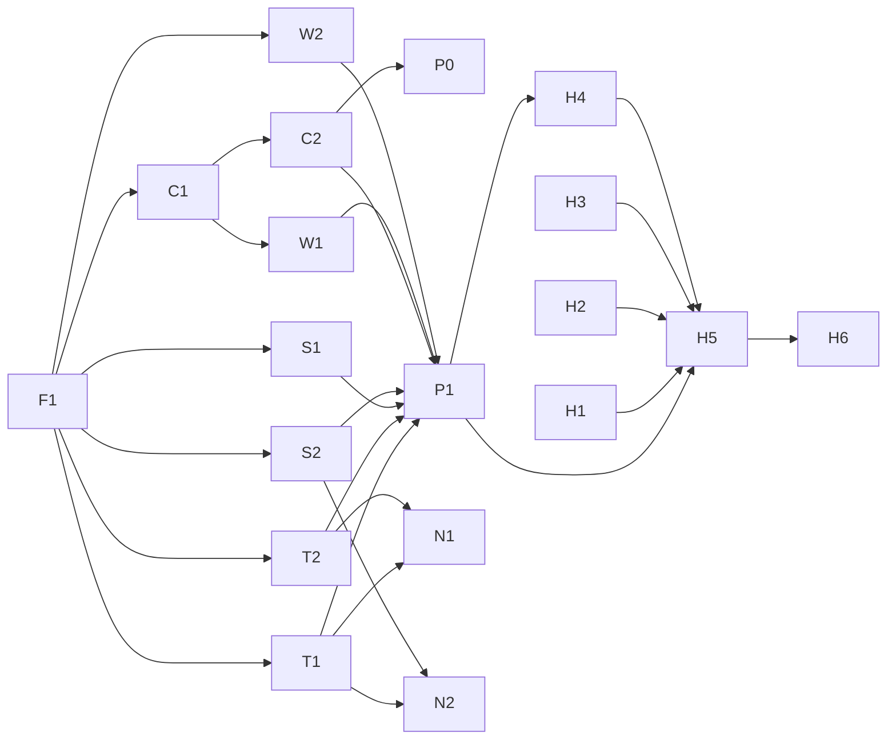
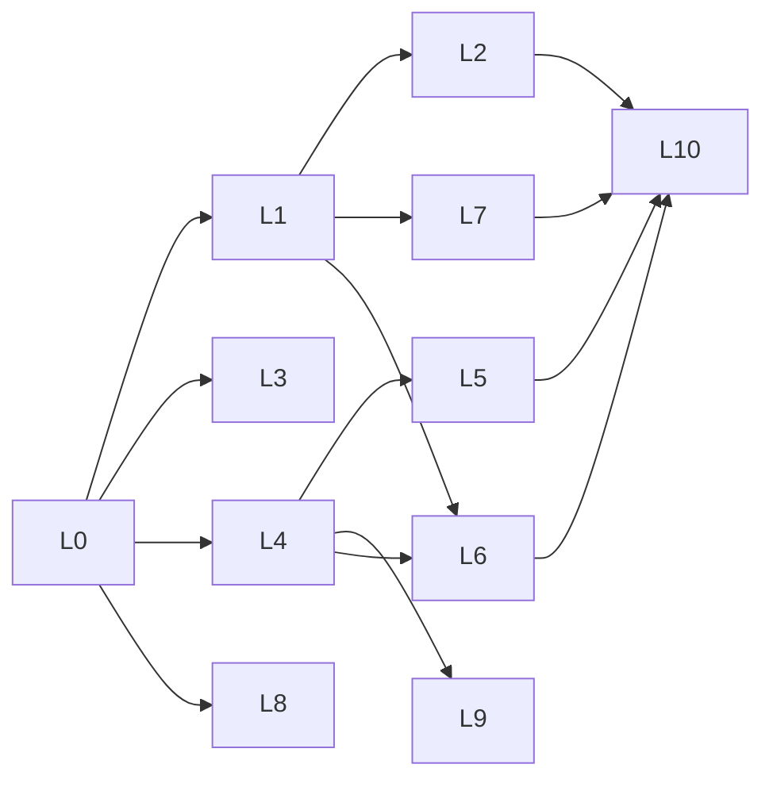

# PRD: Sea & Sky Ink Frame

The plan for turning the PhotoPainter slideshow into a frame that shows tides by day, a
photo every hour and the night sky after dark, controlled from a web dashboard. It is
also the task tracker: work is assigned from [Tasks](#6-tasks), and the coordinator keeps
the status there current (see [Working agreement](#7-working-agreement-for-agents)).

- **Owner:** Kenneth (builds and administers the frame remotely)
- **Viewer:** the person whose wall it hangs on, near the Wedge in Newport Beach, CA, with
  a window facing the southern sky
- **Last updated:** 2026-11-03

Read [CLAUDE.md](CLAUDE.md) (how the repo works today) and
[docs/hardware.md](docs/hardware.md) (panel and Pi facts) before starting a task. Where
this file and CLAUDE.md disagree about what *exists*, CLAUDE.md wins; this file describes
what we are *building*.

## 1. Goals

1. **Daytime:** a glanceable "day screen" for the Wedge. Its centerpiece is the tide
   (the tide now, today's curve, next high and low). Around it: the weather (now, today's
   high and low, wind, rain chance), the surf (wave and swell height, period, direction,
   water temperature), sunrise and sunset, and the moon phase.
2. **Every hour:** a photo for about 10 minutes, then back to tides.
3. **After sunset:** a chart of the sky as seen through the Viewer's south-facing window
   (moon, planets, main constellations), redrawn about hourly, with the weather in a corner.
4. **Remote control:** the Owner can see exactly what is on the wall, switch screens, pick
   the next photo, upload photos and change settings from anywhere.
5. **Plug and play:** the Viewer plugs it in and it works. Their Wi-Fi is preloaded.
6. **No babysitting:** it keeps working through Wi-Fi outages, power cuts and bad settings,
   and the Owner can fix anything remotely.

### Non-goals for v1

- Running on the battery between updates (sleep and RTC wake-up): the board can't wake
  the Pi (`docs/hardware.md`, 2026-11-04). The frame stays plugged in; a battery is a UPS,
  read by the tick (CLAUDE.md "Power and battery rules").
- Cloud photo album sync. Photos come from the dashboard or `scripts/sync-photos.sh`.
- A calendar. (Weather is on the day screen.)
- True breaking-surf height at the Wedge. v1 shows the offshore swell model (see D9).
- Reaching the dashboard from the public internet without Tailscale.
- More than one frame.

## 2. User stories

| # | As the… | I want to… | Done when |
|---|---|---|---|
| U1 | Viewer | see the tide, weather, surf, sun and moon at a glance | The day screen shows them during daylight |
| U2 | Viewer | see a family photo now and then | A photo shows from :00 to :10 each hour (configurable) |
| U3 | Viewer | know what planets and constellations are out my window tonight | Sky screen shows them after sunset, matching the real sky |
| U4 | Viewer | never touch it | It survives reboots, outages and power cuts on its own |
| U5 | Owner | see exactly what's on the wall from anywhere | Dashboard shows the last image sent to the panel |
| U6 | Owner | switch to tides / sky / a photo now | One tap; the panel starts changing at once, or right after a refresh under way |
| U7 | Owner | choose which photo comes next, upload and hide photos | Dashboard photo grid with Show now / Up next / Hide / Upload |
| U8 | Owner | change settings without visiting | Dashboard settings form; bad values are rejected |
| U9 | Owner | know when something is wrong and fix it | Dashboard health panel + SSH over Tailscale |

## 3. Behavior

### Default schedule

| When | Shows | Redraws |
|---|---|---|
| Sunrise → sunset | The day rotation, `schedule.day` (default: every screen for 10 min an hour, in this order: a photo at :00, the day screen, scene kind `tides`, at :10, the harbor chart at :20, the sky at :30, the sea at :40 and the combo at :50; D15) | At every step of the rotation |
| A photo step, in either rotation | Photo (the Up next queue first, then next in the photo rotation) | Once per step |
| Sunset → sunrise | The night rotation, `schedule.night` (default: the sky chart alone, 60 min a step, each drawn for the middle of its step) | At every step |
| Quiet hours (off by default) | Whatever was last shown | Scheduled changes are skipped; dashboard actions still apply |

**Rotations** (2026-11-04): `schedule.day` and `schedule.night` are each an ordered list of
steps `{"screen": "tides" | "sky" | "sea" | "photo" | "harbor" | "combo", "minutes": N}` (1 to
12 steps, 3 to 1440 min),
cycling from local midnight so a 30/30 rotation changes on :00 and :30. A one-step list is
one screen redrawn every N minutes, so `[photo 60]` alone is a slideshow, and photos at
night are a step in `schedule.night`. With no photos to show, the time of a photo step goes
to the screens beside it. The old `tides_refresh_minutes` / `sky_refresh_minutes` keys load
as one-step rotations. The dashboard's Schedule settings edit them (a handle on each row
drags it to a new place in the list, or moves it with the up and down arrow keys) and show
about how many refreshes an hour they make, since each one is a 30-second flash. The order
sets which minutes each screen gets: `[photo 10, tides 50]` shows the photo at :00–:10,
`[tides 50, photo 10]` at :50–:00.

An old file's `schedule.photo` rule folds into the rotations when it loads, and `to_dict`
writes only the new form. For each period its `during` allows: when the rotation's cycle
divides `every_minutes`, the list becomes the photo step, then the old steps repeated up to
`every_minutes` with the first shortened by `show_minutes` (`[tides 30]` with a photo 10 min
every 60 is `[photo 10, tides 20, tides 30]`). Otherwise the photo step goes first and the
first step is shortened, or dropped if it would fall under 3 min, so photos no longer come
exactly every `every_minutes`. `at_minute` is ignored, `enabled: false` leaves the rotations
alone, and `show_minutes` becomes `photos.show_now_minutes`.

All times are local (`America/Los_Angeles`), computed from the frame's location. The
default works out to 6 refreshes an hour by day and 1 at night.

### Dashboard overrides

- **Mode pin:** Auto, Tides, Sky or Photo. A pin lasts until a chosen time. The default is
  "until the next scheduled change" (sunrise or sunset), with "1 hour" and "until I change
  it" as other choices. Pins must expire by default so the frame can't get stuck on one
  screen at a house the Owner can't easily visit. The Frame box also offers the color test card,
  pinned for an hour (`docs/hardware.md`, "Measuring the ink colors").
- **Show now (photo):** pins that photo for `photos.show_now_minutes`, then returns to the
  schedule.
- **Up next:** queues photos for the next photo steps, ahead of the rotation.
- **The buttons on the back:** forward and back step through the running rotation, which carries on
  from there until the period or the day ends. Forward held for a second, then let go, goes to photos
  only (forward and back go through the photos) and, again, back to the schedule as set. Both held
  for a second turn low power on or off, and Back held for a second starts Wi-Fi setup when there's no
  Wi-Fi (`buttons.py`, `hotspot.py`). The dashboard's Help box says so in plain words, with a drawing
  of the frame's back.
- **No wait between refreshes:** an action goes up at once, or right after a refresh under way
  (one running, one queued). The guard that made it wait was removed on 2026-11-06.

### When things go wrong

| Situation | Frame does |
|---|---|
| No internet | Keeps going: tides are cached weeks ahead; the sky, sun and moon are computed locally; photos are local. Weather, surf and the measured water level show their age once over 2 h old and are hidden once over 12 h old (the tide falls back to the table alone) |
| Clock not trustworthy (no NTP sync, no RTC) | Keeps the current image; after 10 min shows photos, a new one an hour, or a "clock not set" message screen with no photos |
| Invalid config file | Uses built-in defaults, reports the error on the dashboard |
| A screen fails to render | Shows the previous image; reports the error; tries again next tick |
| No Wi-Fi | Keeps going, as with no internet, and reconnects by itself: an outage never needs anyone. After 10 min, screens drawn from then on carry a small mark (D14) |
| New router, new password or new house | The same, until someone holds the Back button: a hotspot and a QR code set up the new network from a phone (`hotspot.py`, H4) |
| Web server crashes | Schedule keeps running (separate process); systemd restarts the server |

## 4. Architecture

```
  Owner's phone/laptop ──Tailscale──┐        Viewer's phone (home Wi-Fi)
                                    ▼          │ http://InkFrame.local
┌────────────────────────── Pi Zero 2 W (always on, USB power) ───────────────────────┐
│                                                                                      │
│  photopainter serve  (systemd service, always running, Flask)                        │
│    dashboard + JSON API ── writes config.json, overrides.json, photos               │
│                         ── reads status.json, current.png                            │
│                         ── starts `photopainter tick` right after an action          │
│                                                                                      │
│  photopainter tick   (systemd timer, every minute, one short run)                    │
│    load config → refresh tide cache if due → read overrides                          │
│    → schedule.decide(now, …) → scene + key                                           │
│    → key changed? render scene → panel refresh → save current.png + status.json      │
│                                                                                      │
│  scenes: tides · sky · photo · message      all render to ink indices (800×480)      │
│  sources: NOAA tides + gauge, Open-Meteo weather + surf (cached)                     │
│  astro: sun, moon, sky via Skyfield + JPL ephemeris + star data (local)              │
└──────────────────────────────────────────────────────────────────────────────────────┘
```

Principles:

- **Only `tick` drives the panel.** The server never calls `PanelDisplay`; it starts a tick.
  The panel lock in `hardware/panel.py` stops two refreshes from overlapping.
- **`decide()` is pure.** Given the time, config, overrides and sun times it returns the
  scene. It never reads the clock or files, so the schedule is fully testable on the Mac.
- **Scene keys drive refreshes.** Each decision carries a key such as
  `tides/2026-11-03T14:10`. The panel refreshes only when the key differs from what's
  showing. Running `tick` twice does nothing the second time.
- **Charts are drawn in exact inks.** Tides, sky and message screens are drawn directly in
  the six ink colors with no anti-aliasing and no dithering, so lines and text stay crisp.
  Only photos are dithered.
- **The preview is the truth.** `current.png` is made from the exact ink indices sent to
  the panel, using the estimated ink colors, so the dashboard shows what's on the wall.
- **Everything outside `hardware/` runs on the Mac**, including every scene, the scheduler
  and the web server (with a fake panel).

### Module layout (new parts marked ★)

```
src/photopainter/
  cli.py              preview | show | next | clear | ★tick | ★serve | ★scene
  ★config.py          Config dataclasses, load/validate, defaults
  ★state.py           paths, atomic JSON read/write under a lock
  ★schedule.py        decide() -> Decision
  ★tick.py            one tick: config → data → decide → render → panel → status
  slideshow.py        (existing) rotation order, last shown
  ★astro/
    sun.py            sunrise/sunset and twilight for a day and place
    moon.py           moon phase, moonrise/moonset
    sky.py            alt/az of stars, planets, moon for a time and place
  ★sources/
    tides.py          NOAA fetch + cache, ensure_fresh()
    weather.py        Open-Meteo forecast fetch + cache, ensure_fresh()
    surf.py           Open-Meteo marine fetch + cache, ensure_fresh()
    gauge.py          NOAA water level fetch + cache of the gap, ensure_fresh()
  ★scenes/
    __init__.py       render_scene() dispatch by kind
    base.py           Scene, SceneContext
    tides.py          the day screen (tides + weather + surf + sun + moon)
    sky.py  photo.py  message.py
  render/
    ★draw.py          InkCanvas: draw in ink indices, bundled font
    layout.py palette.py pipeline.py   (existing)
  hardware/           (existing) + ★fake.py: FakePanel for tests and --fake-panel
  ★web/
    server.py         Flask app factory + API
    static/           index.html, app.js, style.css (no build step, no CDN)
★data/
  fonts/              bundled font + its license
  stars.json          bright stars (committed)
  constellations.json constellation lines (committed)
  README.md           data sources and licenses
  de421.bsp           JPL ephemeris (gitignored, fetched by script, rsynced by deploy)
★config.example.json
deploy/systemd/       ★photopainter-tick.{service,timer}, ★photopainter-web.service
```

### Decisions

| # | Decision | Why |
|---|---|---|
| D1 | Always on USB power; a battery is a UPS, not a power source | It's plugged in at the Viewer's house, and the board can't wake the Pi (`docs/hardware.md`, 2026-11-04). |
| D2 | Dashboard hosted on the Pi; reached via Tailscale from anywhere and `InkFrame.local` on the Viewer's Wi-Fi (the name is a dashboard setting) | One codebase, instant actions, no cloud service to keep in sync. Cost: unreachable while the frame is offline. A cloud relay can be added later (backlog). |
| D3 | Flask (`python3-flask` 3.1 in Trixie apt) | Mature, built-in test client, file uploads. Fits the no-pip rule. |
| D4 | Tides from NOAA CO-OPS station **9410580** (Newport Bay Entrance), MLLW, feet | At the harbor mouth by the Wedge; free, no key. Verified 2026-11-03. |
| D5 | Sky via Skyfield (`python3-skyfield` 1.53 in Trixie apt) + JPL `de421.bsp` + committed star/constellation JSON | Accurate, offline, apt-installable. |
| D6 | Config is JSON at `~/.config/photopainter/config.json`, `config.example.json` committed | The dashboard writes it; replaces the planned `config.toml`. |
| D7 | Location = the Wedge's public coordinates (33.593, −117.882), never the Viewer's address | Close enough for tides and sky; keeps the address out of the repo. |
| D8 | Secrets (Wi-Fi password, Tailscale keys) live only on the Pi, never in git | CLAUDE.md rule. |
| D9 | Weather and surf from Open-Meteo (forecast and marine APIs): °F, mph, ft | Free, no key, JSON, one provider. CC BY 4.0, non-commercial: credit it in `data/README.md` and the dashboard. The marine model is offshore (cell nearest the Wedge: 33.625, −117.875), so it gives swell and wave height off Newport, not breaking height at the Wedge; label it as swell. Water temperature is the model's too, because NOAA 9410580 has no sensors. Verified 2026-11-03. |
| D10 | Moon phase computed locally (`astro/moon.py`, Skyfield) | No network; shared by the day and sky screens. |
| D11 | Measured water level: Newport's table + the gap between the Los Angeles gauge (9410660, 39 km away) and its table. Ahead of now, the last 25 h's mean gap, held steady | Kelvin waves ran the water 1.3 ft over the tables in fall 2026, and NOAA's Newport gauge stopped reporting in January 1994. Tested against that gauge in 1982, 1983, 1988, 1992 and 1993: 0.06-0.11 ft RMS off, against 0.23-0.34 ft for the table alone. Holding the gap at the LA gauge, Oct 1-Nov 4 2026: 0.21 ft off two days ahead, against 1.28 ft. Label it an estimate; it can't see a new wave or storm coming. Open-Meteo's modeled sea level was off by about 0.4 ft, so it isn't used. Verified 2026-11-04. |
| D12 | Two buttons on the P1 header (RXD, TXD, GND), with a long press and both held for the other actions, and their own service | The Owner would rather not solder to the Pi; P1 is fitted and has just two free signal pins. Low power stops the dashboard, so the buttons can't live in it. |
| D13 | Help on the dashboard is words and a labelled drawing, with nothing to press | The Owner tried on-screen buttons that really pressed and found it confusing that they worked. |
| D14 | No Wi-Fi: normal screens and a small mark, and a setup hotspot only when someone holds the Back button | An outage must never need anyone. The radio can't look for the home network while a hotspot is up, so one that started by itself would slow the frame's own recovery. Built on NetworkManager rather than `comitup`, which would bring a second web page for port 80 and its own control of the radio. |
| D15 | Default schedule (2026-11-08): by day every screen for 10 minutes an hour, a photo at :00, then tides, harbor, sky, sea and the combo at :50; by night the sky alone, hourly | The old default, `[photo 10, tides 50]`, dates from when there were two screens. This is the rotation the Owner runs on the frame: every screen comes round once an hour, a photo starts each hour and the combo, all four at once, ends it. The cost is 6 refreshes an hour by day, each a 30-second flash. The night stays the approved sky, one refresh an hour while people sleep (Owner's choice). A config saved from the dashboard keeps its own rotations; only a file without `schedule.day` gets the new one, and an old file's `schedule.photo` rule still loads as `[photo 10, tides 50]`. |
| D16 | *(planned, M4)* Sleep between screen changes by cutting the power, woken by the RTC alarm through a latch mod. A mode switch: on = awake with Wi-Fi and the dashboard, off = low power (sleep on the pack, Wi-Fi only in data windows). A button shows the next screen, waking the frame if it has to. | The board can't wake the Pi on its own; the mod is a handful of starter-kit parts and a few wires. A physical switch is clearer than rules about USB power, and the button gives the Viewer a way to see the next photo. Chosen 2026-11-05. |

## 5. Contracts

These are the seams between tasks. Agents may rely on them before the code exists (use
fixtures or stubs) and **must not change them without the Owner's OK**. If a contract
turns out wrong, stop and raise it rather than working around it.

### Paths

| What | Path on the Pi | Override (Mac/tests) |
|---|---|---|
| Config | `~/.config/photopainter/config.json` | `PHOTOPAINTER_CONFIG` |
| State dir | `~/.cache/photopainter/` (existing) | `PHOTOPAINTER_STATE_DIR` |
| Photos | `~/photos/` (from config) | config `photos.folder` |
| Data | `<repo>/data/` | `PHOTOPAINTER_DATA_DIR` |

State dir contents: `panel.lock`, `slideshow.json` (existing);
`overrides.json`, `status.json`, `current.png`, `incoming.png`, `tides.json`, `weather.json`,
`surf.json`, `gauge.json`, `photo-previews/` (new).
All JSON writes go through `state.py`: write to a temp file, then rename, holding an
`fcntl` lock for read-modify-write. The server and tick both write `overrides.json`.

All timestamps are ISO 8601 with a UTC offset. All `datetime`s in code are timezone-aware.

### Config (`config.example.json`)

```json
{
  "location": {"name": "The Wedge", "lat": 33.593, "lon": -117.882,
               "timezone": "America/Los_Angeles"},
  "display": {"portrait": false, "flip": false},
  "schedule": {
    "day": [{"screen": "photo", "minutes": 10}, {"screen": "tides", "minutes": 10},
            {"screen": "harbor", "minutes": 10}, {"screen": "sky", "minutes": 10},
            {"screen": "sea", "minutes": 10}, {"screen": "combo", "minutes": 10}],
    "night": [{"screen": "sky", "minutes": 60}],
    "night_offset_minutes": 0,
    "quiet_hours": null
  },
  "tides": {"station": "9410580", "datum": "MLLW"},
  "weather": {"enabled": true},
  "surf": {"enabled": true},
  "gauge": {"enabled": true, "station": "9410660"},
  "sky": {"center_azimuth_deg": 180, "field_of_view_deg": 140, "max_altitude_deg": 80,
          "magnitude_limit": 4.5, "constellation_lines": true, "labels": true},
  "battery": {"indicator_volts": 3.6, "low_volts": 3.3, "capacity_mah": 2000, "low_power": false,
              "low_power_after_minutes": 1, "data_every_hours": 2.0},
  "photos": {"folder": "~/photos", "fit": "auto", "hidden": [], "show_now_minutes": 10}
}
```

- `battery.indicator_volts`: running on the battery below this, every screen carries a small
  battery indicator, with one redraw to put it up (3.0–4.2; 4.2 means the whole time it's on
  the battery).
- `battery.low_volts`: running on the battery below this, the tick keeps a photo that's up or
  moves to the next one, and waits for power (3.0–4.1; 3.3 V, about 17 minutes
  before the 3.00 V cutoff measured on 2026-11-07).
- `battery.capacity_mah`: the pack's rating, for the dashboard's time-left guess.
- `battery.low_power`, `low_power_after_minutes`, `data_every_hours`: on the battery for
  that long, Wi-Fi and the dashboard go off, with Wi-Fi back for a few minutes every
  `data_every_hours` for the caches (`power.py`; CLAUDE.md "Power and battery rules").

- `photos.show_now_minutes`: how long the dashboard's Show now pins a photo.
- `night_offset_minutes`: night starts this long after sunset (and ends as long before
  sunrise). 0 = at sunset.
- `quiet_hours`: `null` or `{"start": "00:00", "end": "05:00"}`.
- Photo color settings stay in `RenderOptions` (CLAUDE.md "Display rules"), not config.
- `weather` and `surf` (added by T1): when disabled, nothing is fetched and the day screen
  leaves that section out. Both use `location`.
- `gauge` (D11): when disabled, nothing is fetched and the day screen shows the tide table
  alone. `station` should be near `tides.station`.

```python
# config.py
def default_config() -> Config
def validate(data: dict) -> Config                       # raises ConfigError with a readable message
def load_config(path: Path | None = None) -> tuple[Config, str | None]
    # never raises: a missing file gives defaults; a bad file gives defaults + error text
```

### Overrides (`overrides.json`)

```json
{
  "pin": {"kind": "sky", "photo": null, "until": "2026-11-03T18:00:00-08:00",
          "set_at": "2026-11-03T16:02:11-08:00"},
  "up_next": ["beach.jpg", "dog.jpg"]
}
```

`pin` is `null` for Auto. `pin.until` `null` = until cleared. `kind` is `tides`, `sky`,
`photo` or `card` (the color test card); `photo` names a file for Show now. Expired pins are ignored by `decide()` and
removed by whoever writes the file next. `tick` pops a photo from `up_next` after it has
been shown.

A button moving the rotation adds `"cycle": {"anchor": "2026-11-03T16:02:00-08:00", "step": 2,
"until": "2026-11-03T16:57:00-08:00"}`: that step of the running rotation started at `anchor` and the
others follow it, until `until` (the end of the day or night, or midnight). A pin comes first. The key is
there only while the rotation is moved; the dashboard's Auto and the long press clear it.

### Status (`status.json`, written by tick) and `current.png`

```json
{
  "updated_at": "…",
  "showing": {"key": "tides/2026-11-03T14:10", "kind": "tides", "photo": null,
              "drawn_for": "…", "refreshed_at": "…", "indicator": false},
  "refreshing": null,
  "next_change": {"at": "2026-11-03T15:00:00-08:00", "kind": "photo"},
  "last_error": {"at": "…", "where": "tides-fetch", "message": "…"},
  "battery": {"volts": 3.72, "milliamps": -181.0, "state": "discharging", "percent": 29,
              "on_battery_since": "…", "indicator": false, "low": false, "read_at": "…"},
  "power": {"mode": "low", "wifi": "off", "since": "…", "window_until": null, "next_window_at": "…"},
  "wifi": {"connected": false, "down_since": "…", "mark": true, "hotspot": false},
  "data": {"tides_fetched_at": "…", "tides_until": "2026-12-15",
           "config_error": null, "clock_ok": true}
}
```

`refreshing` is `{"key", "started_at", "panel_at"}` while a screen is drawn and the panel updates:
`panel_at` is null until the panel starts. From then until it ends, `incoming.png` is the new
picture; the dashboard flashes from `panel_at` and changes to it 15 s in, as the panel does.
`current.png` is `preview_image(indices)` of the last image the panel finished showing, at canvas size.
`battery` is the tick's reading (`hardware/battery.py`), or `null` without one (a Mac, or
the chip not answering): `state` is `none`, `charging`, `discharging` or `idle`; `low`
means discharging below `battery.low_volts`, and `indicator` the same for
`battery.indicator_volts`; each stays true until a tick sees the frame off the battery.
`showing.indicator` says the image on the wall has the battery indicator on it.
`power` is the low-power state (`power.py`): `mode` `normal` or `low`; `wifi` `on` or
`off`; `since` when the mode last changed; in low power, `window_until` while a data
window is open, else `next_window_at`. `null` before the first tick with the feature.

`wifi` is whether the frame is on Wi-Fi (`hotspot.py`): `connected` is null when it can't say or
Wi-Fi is off on purpose in low power; `down_since` when it went, kept while the hotspot is up; `mark`
whether screens drawn now carry the no-Wi-Fi mark; `hotspot` whether the setup hotspot is up. `showing`
says which image on the wall has it (`no_wifi`). The hotspot's own state, with its password, is in
`hotspot.json` and never in the status.

### Tide cache (`tides.json`)

```json
{
  "station": "9410580", "datum": "MLLW", "units": "ft", "fetched_at": "…",
  "hilo":  [{"t": "2026-11-03T05:27:00-08:00", "v": 4.711, "type": "H"}, …],
  "curve": [{"t": "2026-11-03T00:00:00-08:00", "v": 2.31}, …]
}
```

`curve` is time-sorted at ≤ 30-minute spacing. The cache should cover at least 14 days
ahead; `ensure_fresh()` refetches when it is older than 24 h or covers less than that.

### Weather cache (`weather.json`)

```json
{
  "source": "open-meteo", "fetched_at": "…", "lat": 33.593, "lon": -117.882,
  "units": {"temp": "F", "wind": "mph"},
  "current": {"t": "2026-11-03T23:00:00-08:00", "temp": 64.5, "code": 3,
              "wind": 4.7, "gust": 10.7, "wind_dir": 316},
  "hourly": [{"t": "…", "temp": 63.1, "code": 3, "precip_chance": 0, "wind": 5.2, "wind_dir": 300}, …],
  "daily":  [{"date": "2026-11-03", "high": 74.3, "low": 57.8, "code": 3, "precip_chance": 0}, …]
}
```

`code` is the WMO weather code that Open-Meteo returns. `wind_dir` is the direction the
wind comes from, in degrees true. `hourly` covers at least 48 h ahead and `daily` at least
3 days. `ensure_fresh()` refetches when the cache is older than 1 h.

### Surf cache (`surf.json`)

```json
{
  "source": "open-meteo-marine", "fetched_at": "…", "lat": 33.625, "lon": -117.875,
  "units": {"height": "ft", "period": "s", "water_temp": "F"},
  "hourly": [{"t": "…", "wave_height": 3.74, "wave_period": 10.95, "wave_dir": 240,
              "swell_height": 2.30, "swell_period": 11.75, "swell_dir": 190,
              "water_temp": 73.2}, …]
}
```

`lat`/`lon` are the model cell the API actually used. Directions are where the waves come
from, in degrees true. `wave_*` is the combined sea state; `swell_*` is the primary swell.
`hourly` covers at least 48 h ahead. `ensure_fresh()` refetches when the cache is older
than 3 h. Open-Meteo returns sea surface temperature in °C; the cache stores °F.

### Gauge cache (`gauge.json`)

```json
{
  "station": "9410660", "units": "ft", "fetched_at": "…",
  "gap": [{"t": "2026-11-03T14:06:00-08:00", "v": 1.292}, …]
}
```

`gap` is time-sorted: each six-minute reading at the gauge minus its table at that moment,
in ft, leaving out missing readings and anything over 6 ft (a broken sensor). A gap doesn't
depend on the datum. It reaches back at least 28 h, or as far as the chart starts plus an
hour. `ensure_fresh()` refetches when the cache is over 30 minutes old or for another
station. NOAA's newest reading can be about half an hour old when fetched.

### Star data

```jsonc
// data/stars.json — J2000; every star a constellation line uses is included, even if faint
{"source": "…", "stars": [[32349, 101.287, -16.716, -1.46, "Sirius"], …]}   // [hip, ra_deg, dec_deg, mag, name]
// data/constellations.json
{"source": "…", "constellations": [{"abbr": "Ori", "name": "Orion", "lines": [[26727, 27366], …]}]}
```

### Python interfaces

```python
# astro/sun.py
@dataclass(frozen=True)
class SunEvents:
    sunrise: datetime; sunset: datetime            # aware, local
    civil_dawn: datetime; civil_dusk: datetime
def sun_events(day: date, lat: float, lon: float, tz: ZoneInfo) -> SunEvents

# astro/moon.py
@dataclass(frozen=True)
class MoonPhase:
    illuminated: float          # fraction of the disc lit, 0–1
    phase_deg: float            # 0 new, 90 first quarter, 180 full, 270 last quarter
    waxing: bool
    name: str                   # "New moon", "Waxing crescent", "First quarter", "Waxing gibbous",
                                # "Full moon", "Waning gibbous", "Last quarter", "Waning crescent"
def moon_phase(at: datetime) -> MoonPhase
def moon_events(day: date, lat: float, lon: float, tz: ZoneInfo) -> tuple[datetime | None, datetime | None]
    # (moonrise, moonset) on that local day; None when it doesn't rise or set that day

# render/draw.py   (ink indices: black 0, white 1, yellow 2, red 3, blue 4, green 5 = palette.INKS order)
INK: dict[str, int]
def font(size: int, bold: bool = False) -> ImageFont.FreeTypeFont     # bundled font, cached
class InkCanvas:
    def __init__(self, size: tuple[int, int], background: str = "white") -> None
    image: Image.Image          # mode "P", palette = the six inks
    draw: ImageDraw.ImageDraw   # draws without anti-aliasing because the image is "P"
    def indices(self) -> np.ndarray   # (height, width) uint8

# scenes/base.py
SceneKind = Literal["tides", "sky", "photo", "message", "card"]
@dataclass(frozen=True)
class Scene:
    kind: SceneKind
    key: str                    # the panel refreshes iff this differs from what's showing
    draw_for: datetime          # the moment the image depicts
    photo: str | None = None    # photo scenes: file name, or None = next in rotation
    message: str | None = None  # message scenes
@dataclass(frozen=True)
class SceneContext:
    config: Config
    canvas: tuple[int, int]     # (width, height): (800, 480), or (480, 800) when portrait
    state_dir: Path
    data_dir: Path
# every scenes/<kind>.py:
def render(scene: Scene, ctx: SceneContext) -> np.ndarray   # (height, width) uint8 ink indices

# schedule.py  — pure: no clock reads, no file or network access
@dataclass(frozen=True)
class Decision:
    scene: Scene
    next_change_at: datetime | None
    quiet: bool                 # inside quiet hours: tick skips scheduled (non-pinned) changes
def decide(now: datetime, config: Config, overrides: Overrides,
           sun: Callable[[date], SunEvents]) -> Decision
```

### CLI

```
photopainter tick [--fake-panel] [--at ISO]
                                                    one tick (run by the timer and the server);
                                                    --at simulates a moment from the caches, no fetching
photopainter serve [--host 0.0.0.0] [--port 80] [--fake-panel]   # the Pi's unit uses --host :: (IPv4 and IPv6)
photopainter scene {tides,sky,photo,message} [--at ISO] [--photo NAME] [-o out.png]
                                                    render a scene to a PNG without the panel (Mac or Pi)
```

### HTTP API (`photopainter serve`)

| Method | Path | Does |
|---|---|---|
| GET | `/` | Dashboard |
| GET | `/api/status` | `status.json` + live health (uptime, CPU temp, Wi-Fi SSID/signal, clock sync) |
| GET | `/api/current.png` | The image on the wall |
| GET | `/api/incoming.png` | The picture a refresh under way is bringing in (404 when none is) |
| GET / PUT | `/api/config` | Read / replace config (validated with `config.validate`; 400 with the message if bad) |
| POST | `/api/mode` | `{"kind": "auto"\|"tides"\|"sky"\|"photo"\|"card", "until": ISO\|null\|"next_change"\|"1h"}` |
| GET | `/api/photos` | `[{"name", "size", "hidden", "up_next_position"}]` |
| GET | `/api/photos/<name>/preview.png` | Dithered preview as it will look on the panel (cached) |
| POST | `/api/photos` | Upload (multipart); resized to ≤ 1600 px, saved to the photo folder, last in the order |
| PUT | `/api/photos/order` | Set the rotation's order: `{"order": [names]}` (kept in `<photo folder>/.order.json`) |
| POST | `/api/photos/<name>/show-now` | Pin this photo for `photos.show_now_minutes` |
| POST | `/api/photos/<name>/up-next` | Add to the queue (`DELETE` removes) |
| POST | `/api/photos/<name>/hide` | Toggle hidden (`DELETE /api/photos/<name>` moves it to `~/photos/.trash/`) |
| GET | `/api/preview.png?kind=sky&at=ISO` | Render a scene without touching the panel; `at` can be a named moment (`2026-11-20@sunset`), and `kind=sea` takes `waves` and `clouds` looks |
| POST | `/api/preview.png` | The same from JSON, with `config`: draw with unsaved settings (checked, never saved) |
| POST | `/api/redraw` | Draw what's on the wall again (the next tick redraws the same screen) |

Every action that changes what should be shown starts `photopainter tick` in the
background. No authentication in v1: the server is only reachable on the Viewer's LAN and
the Owner's tailnet. Never port-forward it or expose it with Tailscale Funnel without
adding a login first.

### Performance budgets (Pi Zero 2 W, 512 MB)

| | Budget |
|---|---|
| `tick` with no change | < 3 s |
| Render tides / photo / message | < 5 s |
| Render sky (including Skyfield import and ephemeris load) | < 15 s |
| `serve` resident memory | < 80 MB |
| Dashboard page load on the LAN | < 2 s |

## 6. Tasks

Status values: `todo` · `in progress (<branch>)` · `review (<PR>)` · `done` · `blocked: <why>`.



### M0: Foundations (one agent, first; blocks M1)

| ID | Task | Depends on | Status |
|---|---|---|---|
| F1 | Shared foundations | — | done (PR #1) |

**F1. Shared foundations.** Files: `config.py`, `config.example.json`, `state.py`,
`astro/__init__.py`, `astro/sun.py`, `scenes/__init__.py`, `scenes/base.py`,
`scenes/message.py` (a plain text screen; also the first real use of `InkCanvas`),
`render/draw.py`, `data/fonts/`, `data/README.md`, `scripts/fetch-ephemeris.sh`
(downloads once to a shared folder outside the repo, such as `~/.cache/photopainter-dev/`,
and links it into `data/` so every worktree reuses one copy; `deploy.sh` already copies
such links as real files),
`cli.py` (all new subcommands; `tick` and `serve` as stubs that call into
not-yet-written modules), `pyproject.toml` (add `skyfield`, `flask`),
`scripts/deploy.sh` (only if needed so `data/` and the ephemeris reach the Pi),
`scripts/flash-sd.sh` + `docs/pi-setup.md` (apt: `python3-skyfield`, `python3-flask`),
`.gitignore` (`data/*.bsp`), tests.
- Accept: every interface in [Contracts](#5-contracts) for these files exists with tests;
  `load_config` never raises; `sun_events` matches NOAA/USNO sunrise and sunset for the
  Wedge on three test dates within 2 minutes; `InkCanvas` text and lines contain only ink
  indices 0–5; `photopainter scene message --message "hello" -o x.png` works on the Mac;
  the font is permissively licensed (OFL or similar) with its license committed;
  `.venv/bin/pytest` passes.

### M1: Screens, brain, dashboard (parallel after F1)

| ID | Task | Depends on | Status |
|---|---|---|---|
| T1 | Day data: tides, weather, surf, moon | F1 | done (PR #2) |
| T2 | Day screen (design with the Owner) | F1 (cache fixtures) | done (PR #3) |
| S1 | Star and constellation data | F1 | done (PR #7) |
| S2 | Sky screen | F1 (star data fixture) | done (PR #7); on the Pi since 2026-11-04 02:25 |
| S3 | Weather on the sky screen | S2, T1 | in review (PR #20) |
| S4 | Eclipses on the sky screen | S2 | done (PR #53); on the Pi since 2026-11-07, judged on the panel |
| C1 | Scheduler | F1 | done (PR #4) |
| C2 | Tick, photo scene, systemd | C1 | done (PR #4) |
| W1 | Dashboard API | C1 | done (PR #5) |
| W2 | Dashboard UI | F1 (API contract; fake data) | done (PR #5) |

**T1. Day data: tides, weather, surf, moon.** Files: `sources/*.py` (`tides.py`,
`weather.py`, `surf.py`, and a shared fetch/cache helper if useful), `astro/moon.py`,
`config.py` + `config.example.json` (add the `weather` and `surf` sections; this contract
change was approved by the Owner on 2026-11-03), `data/README.md` (credit Open-Meteo),
`tests/fixtures/noaa_*.json`, `tests/fixtures/openmeteo_*.json`, `tests/test_sources.py`,
`tests/test_moon.py`.
- Each source's `ensure_fresh()` fetches only when its cache is stale per the contract,
  uses a 10 s network timeout, and never raises: on failure it keeps the old cache and
  returns the error for `status.json`. Pass `application=photopainter` to NOAA. Don't send
  personal details (no email) in User-Agent headers.
- `moon_phase` and `moon_events` per the contract.
- Accept: tests use recorded API responses (no network in tests); stale or short caches
  trigger a fetch, fresh ones don't; a failed fetch keeps the old cache; disabled
  sources don't fetch; the °C→°F water temperature conversion is tested; moon phase names
  and illumination match published new/full/quarter moon times for November 2026 within
  a few hours.

**T2. Day screen.** Files: `scenes/tides.py`, `tests/fixtures/{tides,weather,surf}.json`
(cache-format fixtures), `tests/test_day_scene.py`.
- **Designed with the Owner:** start with rough layout sketches (2–3 previews), let the
  Owner choose a direction, then refine. The Owner sets the priorities between sections.
- Content: tide (today's curve with a "now" marker, current height and rising/falling,
  next high and low with time and height); weather (now: temperature and condition icon;
  today's high/low, wind speed/direction/gusts, rain chance); surf (wave and swell height,
  period and direction, water temperature, labeled as swell, not Wedge surf height; see
  D9); sunrise and sunset; moon (phase drawing, name, % lit). Plus place name, date and a
  small "updated" time.
- Weather and surf age: show the time they're from when over 2 h old; leave the section
  out when over 12 h old, missing, or disabled in config. Until T1 lands, show sections
  whenever their cache exists; wire up `config.weather.enabled` / `config.surf.enabled`
  after merging `main` with T1 in it.
- Weather icons are drawn in inks by our own code (or from an OFL-licensed icon font,
  committed with its license). Readable from across a room. 800×480 landscape (Q6 open).
- Moon phase until T1 lands: compute it inline or stub it, matching the `astro/moon.py`
  contract, and switch to T1's module after merging `main`.
- Panel checks: only when the Owner asks, and while no other session uses the Pi. Use
  `scripts/show.sh previews/<x>.png --saturation 1 --vibrance 0 --no-dither`. The
  slideshow timer replaces the image within 3 minutes unless the Owner pauses it with
  `ssh photopainter sudo systemctl stop photopainter-next.timer` (start it again after).
- Accept: renders from the fixtures at several times of day and with weather/surf
  missing or stale, without errors; output is exactly the canvas size and uses only inks;
  the Owner approves the design.

**S1. Star and constellation data.** Files: `scripts/build-star-data.py`,
`data/stars.json`, `data/constellations.json`, `data/README.md` (append sources).
- Bright stars to magnitude 5 plus every star used by a constellation line; lines for at
  least the constellations visible from 33.6° N; common names for the brightest ~50 stars.
- Use sources whose licenses allow redistribution in this repo; record source, version and
  license in `data/README.md`. The script is run on the Mac only.
- Accept: files match the contract; every line endpoint resolves to a star; total size
  under 500 KB.

**S2. Sky screen.** Files: `astro/sky.py`, `scenes/sky.py`, `schedule.py` (only to switch
`_night_scene` from the MVP fallback to the sky, as its comment describes), `tests/fixtures/stars_small.json`,
`tests/test_sky.py`.
- Positions (alt/az) of stars, the Moon and the naked-eye planets for a time and place,
  using Skyfield and `de421.bsp`. The Moon's phase comes from T1's `astro/moon.py`; add
  the bright-limb angle here.
- Draw the view through the window: horizon straight along the bottom, centered on
  `center_azimuth_deg` with `field_of_view_deg` across, up to `max_altitude_deg`. Black sky,
  white stars sized by magnitude, constellation lines and names in a dim ink, planets as
  labeled colored discs, the Moon with its phase, compass labels on the horizon, the time
  drawn for. Pick and document the projection.
- Accept: positions agree with a reference (JPL Horizons or Stellarium) within 0.5° for
  the Moon and two planets on two dates; renders within budget on the Pi (checked in P1);
  2–3 style variants as previews for the Owner to pick.

**S3. Weather on the sky screen.** Files: `scenes/sky.py`, `tests/test_sky.py`, CLAUDE.md.
- The weather in the top-left corner in place of the time and date (Owner, 2026-11-04,
  chosen over labeled previews of four places): the condition with an icon, the
  temperature, today's high and low, and the wind with an arrow pointing the way it blows
  as seen from the window. It uses the day screen's weather cache, age rules and helpers
  (`scenes/tides.py`); a clear night gets stars for an icon, since the day screen's
  crescent would pass for the real Moon.
- Top right: the next sunrise or sunset, all day and all night (the sunrise used to be
  left out after dark), the moonrise while the Moon is down, soonest first, and "Sky at
  9:30 pm" in small letters for the moment the sky is drawn for.
- Accept: the corner is reserved before the sky is drawn so names keep clear of it; tests
  for the model, the box the block takes, the icons and the order of the notes; judged on
  the panel after deploy.

**S4. Eclipses on the sky screen.** Files: `astro/eclipse.py`, `scenes/sky.py`,
`scenes/combo.py`, `tests/test_eclipse.py`, CLAUDE.md.
- Drawn only when seen from the Wedge: the Moon red in Earth's real shadow or the Moon across
  the Sun, to scale and turned the way they really are.
- Named for every eclipse on Earth, like the day screen's icons: a note top right from 12 h
  before it begins, its kind anywhere ("Total solar eclipse" though it's partial here), then
  what's seen here, or "not seen here" (`scenes/sky.py` docstring).
- Accept: contact times within 90 s of the published ones; the kind and greatest eclipse of
  every eclipse of 2024-2027 as in NASA's catalogs; every other moment renders exactly as
  before; judged on the panel.

**C1. Scheduler.** Files: `schedule.py`, `tests/test_schedule.py`.
- Implement `decide()` per [Behavior](#3-behavior): pins, photo slots (`during`), day/night
  with `night_offset_minutes`, refresh buckets and keys, `next_change_at`, quiet hours.
  Also export helpers the server needs: resolving `"next_change"` and `"1h"` to a time.
- **MVP night fallback** (Owner, 2026-11-04): until the sky screen (S2) exists, night shows
  the day screen, redrawn every `sky_refresh_minutes`. Keep the fallback in one obvious
  place so S2 can remove it, and make `status.json` report the kind actually shown.
- Accept: table-driven tests covering sunrise and sunset edges, a DST change day,
  photo-slot start and end, expired and unexpired pins, quiet hours across midnight, and
  "same inputs a minute later give the same key" within a bucket.

**C2. Tick, photo scene, systemd.** Files: `tick.py`, `scenes/photo.py`,
`hardware/fake.py` (FakePanel: same `show`/`clear` interface and refresh-guard behavior,
no GPIO, used by tests and `--fake-panel`), `deploy/systemd/photopainter-tick.{service,timer}`,
`tests/test_tick.py`; remove `photopainter-next.*` units and update `scripts/deploy.sh`
and CLAUDE.md to match.
- The tick algorithm in [Architecture](#4-architecture), writing `status.json` (including
  `refreshing` before the panel starts) and `current.png`; popping `up_next`; skipping
  hidden photos; clock check (`clock_ok`: NTP
  synced or a valid RTC); message screens for the failure cases in
  [When things go wrong](#when-things-go-wrong) except Wi-Fi (H4). Data refresh uses
  T1's `sources.ensure_all_fresh(config)`; its errors go into `status.json`. Keep
  `photopainter next` and `scripts/next.sh` working for manual use.
- Accept: tests with a fake panel and fake clock cover: no change → no refresh; key change
  → one refresh and status updated;
  render error → previous image kept and error reported; Up next consumed exactly once.

**W1. Dashboard API.** Files: `web/__init__.py`, `web/server.py`, `web/health.py`,
`deploy/systemd/photopainter-web.service`, `tests/test_web.py`.
- Every endpoint in the [HTTP API](#http-api-photopainter-serve) table. Starts ticks with
  `subprocess.Popen` (non-blocking). Uploads: the browser converts each photo to JPEG at
  ≤ 1600 px before sending (the Pi's Pillow can't read HEIC and Debian has no HEIF plugin;
  Safari can decode it). The server accepts JPEG/PNG/WebP, shrinks anything over 1600 px,
  and refuses files over 25 MB. Validate photo names (no paths). Health includes each
  data source's last fetch and error from T1's `sources.json`.
  `--fake-panel` for running on the Mac. The systemd unit runs as `pi` with
  `AmbientCapabilities=CAP_NET_BIND_SERVICE` so it can serve on port 80. After the merge
  the coordinator deploys and enables it; until H1 (Tailscale) it is reachable only on the
  LAN at `http://InkFrame.local`.
- Accept: Flask test-client tests for every endpoint including bad config (400), bad photo
  name (400/404) and upload resize; runs on the Mac with `--fake-panel`.

**W2. Dashboard UI.** Files: `web/static/*`.
- Phone-first single page: the current image in a frame mock-up at the top with "drawn
  at" and "next change"; a refreshing indicator; mode buttons with an "until"
  choice; photo grid (panel-style previews) with Show now / Up next / Hide / Delete /
  Upload; settings forms generated from the config, a box per screen with a preview of any
  time (the Sea's also of any kind of day) and the settings several screens share in a
  Frame box; a Battery box with the reading, low power, the chart and its settings; a Help
  box saying what the buttons on the back do; health panel. Polls `/api/status`
  every 10 s. Plain HTML/CSS/JS, no build step, no external CDN.
- Accept: works against the W1 API on the Mac with `--fake-panel`; usable at 375 px wide;
  every action shows success or the server's error message.

### M1b: More screens for the desk (parallel, after M1)

| ID | Task | Depends on | Status |
|---|---|---|---|
| N1 | Harbor chart screen | T1, T2 | done (PR #26) |
| N2 | Sea screen | T1, S2 (skyline) | done (PR #24) |
| N3 | Combo screen | T2, S2, N1, N2 | built; not yet judged on the panel |

N1 and N2 were mocked up first and the Owner approved the mockups on 2026-11-04 (kept outside
the repo in `~/.cache/photopainter-dev/mockups/`, with the throwaway scripts that drew them),
then changed details over previews while they were built. This is what was built; the module
docstrings and CLAUDE.md "Display rules" have the choices. Each adds one screen kind to
`scenes/base.py`, `schedule.py`, `web/server.py` and `web/static/app.js`. All three were
added to the default day rotation on 2026-11-08 (D15).

- **N1. Harbor chart screen** (`scenes/harbor.py`, `scripts/build-harbor.py`,
  `data/harbor.json`): lower Newport Bay as a nautical chart, north up, from OpenStreetMap
  shorelines (ODbL: credit "© OpenStreetMap contributors" in `data/README.md` and on the
  dashboard). Buff land, blue-dot harbor water, a much paler ocean, green marsh, the
  piers, jetties and channel beacons, island names. Today on it: a tide band along the bottom
  (the day screen's chart at a smaller size, by default 24 h back to 4 days ahead, with its
  own settings), the swell and wind in words in the title block, wind arrows over the ocean, longer
  the harder it blows, two blue swell arrows offshore, and the Sun (and the Moon when up) on the compass rose's rim at their
  azimuths with sunrise and sunset ticked. Soundings are NOAA ENC depths, never typed by hand.
- **N2. Sea screen** (`scenes/sea.py`): today's ocean from the window, drawn woodblock-style
  rather than charted. Rows of crests in perspective; swell height sets their size and when
  foam breaks off them, period how far apart they are and the wavelength, direction (against
  the window's bearing) the tilt; wind adds chop and, from about 10 mph, whitecaps. The
  forecast's weather code picks the sky (clear, two clouds or overcast), since the cache has no
  cloud cover; the Sun is a disc at its real bearing and height, with no reflection on the
  water. Catalina on the horizon from `data/skyline.json`; the beach along the bottom narrows
  with the tide; the jetty runs out from the bottom left, with flat water beyond it. The words
  sit in a plain box top left, with arrows for the swell's and wind's directions and a small
  "Updated" line. A dark version with the Moon after sunset is still a variant, not yet chosen
  by the Owner. The dashboard's Sea box previews any time and, for previews only, a wave look
  and a cloud look in place of the forecast.
- **N3. Combo screen** (`scenes/combo.py`, asked for by the Owner on 2026-11-05): the tides,
  the sky, the harbor chart and the sea at once, each in a quarter of the panel. The left
  column is the tide over the chart, the right the view from the window, the sky over the sea.
  Each panel is its screen's own drawing at a smaller size, not a shrunken image, and says only
  what the others don't. It has no settings of its own: it follows the tides, sky and harbor
  settings. The options it added to `scenes/sky.py` and `scenes/sea.py` default to the approved
  screens: the four full-size screens hashed the same before and after, at five moments.

### M2: On the panel (one agent with Pi access + the Owner's eyes)

| ID | Task | Depends on | Status |
|---|---|---|---|
| P0 | MVP cutover: `tick` runs the frame | C1, C2 | in progress: `tick` has run the Pi since 2026-11-04 00:34; confirm the first real photo slot (07:00) and sunset (16:56) |
| P1 | Integrate and check on the panel | M1 | todo |
| P2 | Measure ink colors (test card) | — | done (2026-11-04): measured, kept the current inks; photos now S1.3 V0.5 |

**P0.** The Owner wants an MVP on the device before the rest of M1. Once C1+C2 is merged,
the coordinator deploys `main`, enables `photopainter-tick.timer`, disables
`photopainter-next.timer`, and watches a photo slot and a sunset change on the panel. The
day screen alone was shown on the panel on 2026-11-04 (rendered on the Pi from live data).

**P1.** Install `python3-skyfield` and `python3-flask` on the Pi with apt, deploy
`main`, enable `photopainter-tick.timer` and `photopainter-web.service`,
run a full day/night cycle (use pins to see each screen), confirm budgets, and tune
designs on the panel using one labeled comparison refresh per question (the method in
CLAUDE.md). Record results in `docs/hardware.md`.

**P2.** Done with the color test card (Settings on the dashboard) and
`scripts/analyze-card.py`, from one RAW shot at dusk with reflections on the panel. Measured
inks with a dither closer to how dots mix scored closer to the target colors but lost on the
panel, so the `estimated` colors and today's dither stay, and the Owner chose S1.3 V0.5 for
photos. Results are in `docs/hardware.md`. Trying the dither again would start with a
reflection-free RAW photo, for a better green.

### M3: Ship to the Viewer's house

| ID | Task | Depends on | Status |
|---|---|---|---|
| H1 | Tailscale on the Pi, key expiry off | — | done (2026-11-04): key expiry off; the dashboard loads on the Owner's phone over cellular |
| H2 | RTC coin cell + kernel RTC driver | coin cell purchased | todo |
| H3 | Viewer's Wi-Fi as a second profile | Q7 answered | todo |
| H4 | No Wi-Fi: a mark on the screen, photos when the clock isn't set, a setup hotspot on a held button | C2 | built (2026-11-07); the hotspot and QR code work on the Pi with an Android phone; joining a network from the page not tried yet |
| H5 | 48-hour soak test | P1, H1–H4 | todo |
| H6 | One-page card for the Viewer | H5 | todo |
| H7 | Battery: readings on the dashboard, battery indicator, a last photo when low | a Li-ion pack | done (2026-11-05): pack fitted (re-pinned, it came reversed), charges at about 2 A from flat, runs the frame at 0.2 A; run-down 2026-11-07: 10 h 42 min, cut out at 3.00 V |
| H8 | Buttons: forward and back through the schedule, a long press for photos only, both held for low power (`buttons.py`, `photopainter-buttons.service`) | H7 | done (2026-11-06): wired to P1 and running. The low-power mark's look and place are the defaults until the Owner picks |
| H9 | Help on the dashboard: what the buttons do, in words and a drawing of the frame's back (`web/static/`) | H8 | done (2026-11-07) |

- **H1:** install from Tailscale's apt repo; disable key expiry for this device in the admin
  console; dashboard and SSH reachable from the Owner's phone on cellular. Document in
  `docs/pi-setup.md` (no keys in git).
- **H2:** fit a 3 V coin cell (JST SH1.0 2-pin, see `docs/hardware.md`), add
  `dtoverlay=i2c-rtc,ds3231`, confirm the time survives a power cut with Wi-Fi off, and make
  `clock_ok` accept a valid RTC.
- **H3:** add the network with `nmcli` from a script that prompts for the password
  (`scripts/add-wifi.sh`); keep the Owner's network too; confirm 2.4 GHz and WPA2 (the Pi
  Zero 2 W has no 5 GHz). Timezone set to `America/Los_Angeles`.
- **H4:** the rules are in `hotspot.py` and CLAUDE.md "No Wi-Fi". Done on 2026-11-07: the hotspot on
  this radio, the QR code from the panel with an Android phone, calling it off and rejoining. To
  finish: that the setup page opens by itself (iPhone and Android), a wrong password and a right one. It replaces the message screen first planned here,
  which would have taken over the frame during an ordinary outage.
- **H5:** 48 h on the wall at the Owner's home, including 24 h with Wi-Fi off and one
  power cut; it recovers with no help (no QR code needed), and the dashboard history makes sense.
- **H6:** what each screen means, what to do if it looks stuck, the Owner's contact.
- **H7:** `hardware/battery.py` reads the INA219 (CLAUDE.md "Power and battery rules");
  the tick writes `status.json` `battery` and `battery.csv`; the dashboard shows the
  reading and warns on battery; since 2026-11-06, on battery below `battery.indicator_volts`
  every screen carries a small battery, and below `battery.low_volts` the tick settles on a
  photo (in place of a "Battery low" text screen) and waits for power, never shutting down. Checked with the pack on
  2026-11-05: polarity (the plug came reversed and was re-pinned), charging with
  the LED on, and pulling USB: the frame kept running and redrawing at about 0.2 A from
  the cell. Full run-down 2026-11-07 (`docs/hardware.md`): 10 h 42 min, cut out at 3.00 V,
  so `battery.low_volts` went from 3.2 V to 3.3 V; about 2.07 A charging from flat.

### M4: Battery frame: wake on RTC (planned 2026-11-05, after M3)

**Goal:** weeks on the pack, by being off between screen changes. The board as built can't
wake the Pi (`docs/hardware.md` "Can the Pi wake itself?"), so this needs a small latch
mod: the DS3231's alarm output and a Pi "hold" pin, joined to the power switch's
transistor (`docs/hardware.md` "The latch mod"). The Owner chose to plan it knowing it
trades the cord for a charge every week or two; whether the Viewer's frame runs this way
at all is Q11. Until B2 and B3 are done, nothing changes: `power.mode` stays `always_on`.

**The wake cycle** (`photopainter tick --wake`, run by `photopainter-wake.service` at
boot when `power.mode` is `wake`):

1. First thing, set a fallback alarm an hour ahead, so a crash later still ends in sleep.
2. Why awake? The RTC's alarm flag is pending → the alarm. Not pending and the mode
   switch is on → the switch. Neither, on battery → the next button. Neither, on USB → the
   power came back. `status.json` records it (`wake`: `alarm` / `switch` / `button` /
   `usb`). A button wake shows the next screen instead of what the schedule says.
3. Decide and draw exactly as the timer's tick does. The panel's refresh guard never
   blocks across boots, and the clock is right from boot thanks to the kernel RTC driver.
4. On a **data wake** (every `power.data_every_hours`, or sooner if a cache is older
   than that or the clock is untrusted): Wi-Fi on, up to 60 s for a connection, fetch,
   let NTP correct the clock and the RTC, Wi-Fi off. Image wakes never touch Wi-Fi.
5. Set the alarm for the sooner of the next schedule change and the next data wake,
   write `sleeping_until` to `status.json`, sync, `systemctl poweroff`. The kernel's
   `gpio-poweroff` overlay drops the hold pin at the very end, and the power with it.

**The mode switch and the next button** (Owner, 2026-11-05; wiring in
`docs/hardware.md` "The latch mod"):

- **Switch on: awake.** Wi-Fi up, the dashboard running, the minute timer ticking, as
  today. It never sleeps, on USB or on the pack (the dashboard warns when the pack runs
  low). Flipping it on while the frame sleeps powers it on.
- **Switch off: low power.** Wi-Fi and the dashboard are off except during a data window
  every `power.data_every_hours`. On the pack, the frame powers off between screen
  changes (the wake cycle above). On USB power it stays powered, since sleeping would
  save nothing, and just changes screens on schedule.
- **The button: the next screen, now.** Asleep, a press powers the frame on and it
  shows the next step of the rotation (a photo step means the next photo) for that
  step's usual time, then sleeps again. Awake, on USB or with the switch on, the same
  press just changes the screen. `photopainter next` and the dashboard's Next do the
  same thing.
- `/boot/firmware/photopainter-stay-awake` still forces awake, whatever the switch says,
  and so does `power.mode` `always_on`, the default. An unmodified board must never try
  to sleep: it would only halt and sit dark (CLAUDE.md "Power and battery rules").

**Numbers** (from the 2026-11-05 readings): a wake is about 70 s (boot without Wi-Fi
~20 s, draw, the 30 s refresh, shutdown ~10 s) at about 0.3 A, so about 6 mAh. Today's
schedule is about 38 wakes a day (photo on and off hourly by day, the sky hourly at
night): about 8 days on 2000 mAh. Photos and tides every 2 hours: about 20 wakes a day,
about 2 weeks. The off-state draw (the charger's quiescent current, the RTC on its coin
cell, the latch parts) should be well under 1 mA; B5 measures it.

**Config (planned):** `power: {"mode": "always_on", "data_every_hours": 2}`, where
`mode` is `always_on` (the board as built) or `switch` (the latch mod is in: follow the
mode switch and the button, on BCM 6 and BCM 5).

| ID | Task | Depends on | Status |
|---|---|---|---|
| B1 | Coin cell, kernel RTC driver with `wakeup-source`, and a bench test that the alarm pulls INT low with the board off (H2, extended) | coin cell | todo |
| B2 | The latch mod: parts, solder, test (alarm turns it on; hold pin low turns it off; the switch still works) | B1 | todo |
| B3 | `hardware/rtc.py` (set/clear the alarm, the wake reason), `hardware/buttons.py` (the mode switch and the next button) and the wake cycle in the tick; `photopainter-wake.service` and a small button-listener service; the `config.txt` lines in `flash-sd.sh`; tests with fakes | B1 | todo |
| B4 | Dashboard: the mode (awake / low power), sleeping until, last wake and why, wakes and mAh per day; a Next button | B3 | todo |
| B5 | Measure mAh per wake, the off-state draw and days per charge; settle the cadence (Q12) | B2, B3 | todo |

- **B1:** `dtoverlay=i2c-rtc,ds3231,wakeup-source` (without `wakeup-source` the driver
  offers no alarm when no interrupt line is wired), drop `fake-hwclock`, `hwclock -w` once
  NTP has set the clock. The driver reports a pending alarm through `RTC_WKALM_RD` and
  clears the flag when the next alarm is set. It also sets the chip's BBSQW bit at
  probe, without which the alarm pin is high impedance on battery power (datasheet;
  `docs/hardware.md` "The latch mod"), so the bench test needs the driver loaded. Bench
  test before any soldering: coin cell in, set an alarm two minutes ahead through
  `/sys/class/rtc/rtc0/wakealarm`, switch the board off, and watch the R18 pad with a
  meter through a 100 kΩ pull-up to the pack's + (the board's own pull-up on INT is dead
  when the board is off). If INT doesn't go low on VBAT, M4 stops here.
- **B2:** the circuit is in `docs/hardware.md`. Parts, all from the Owner's RexQualis
  starter kit: two PN2222 transistors, two 1N4007 diodes, two 100 kΩ and one 10 kΩ, built
  on the kit's breadboard first and then on a scrap of the Owner's perfboard; solder
  points: the unfitted R18 (INT), the unfitted R19 (BCM 26, the hold pin), the two pads of
  the switch Key1 (SYS and the gate node), and ground.
- **B3:** the wake cycle above, as a second entry point beside the timer's tick, sharing
  everything after the clock check. Fakes for the RTC and the power-off so the cycle is
  tested on the Mac. The hold pin is set by the firmware (`gpio=26=op,dh` in
  `config.txt`), before the kernel: the alarm flag stays set, and INT low, until the
  driver touches it, which is later.
- **B3, the button and switch:** while awake, a listener (gpiozero, debounced) turns a
  press into a Next override and starts a tick, and reacts to the switch flipping off by
  starting the sleep cycle. Asleep, both act through the latch; the wake cycle reads the
  wake reason first. A press during a wake cycle may be missed; that's acceptable.
- **Done** means: a week on the pack at the chosen cadence with no help, the dashboard
  reachable within a minute of flipping the switch on, the button changing the screen
  within about a minute asleep and at once awake, and plugging USB in with the switch on
  behaving as the frame does today.

### Backlog (not v1)

- Nearshore surf height at the Wedge (for example CDIP's MOP model) instead of offshore swell.
- Cloud relay so the dashboard shows "last seen" while the frame is offline.
- Dashboard PIN, required before any public exposure.
- Perceptual (Lab) dithering for photos.
- ~~Sleeping on the battery between updates~~: planned as M4 (2026-11-05), with the
  hardware mod it needs.

## 7. Working agreement for agents

1. **The coordinator owns the Status column.** The Owner, or the session they coordinate
   from, assigns tasks and updates statuses on `main`. Agents don't edit this file on their
   branches: adjacent table rows edited on separate branches conflict on merge.
2. **Every session that writes code works in its own git worktree** (required), on a
   branch whose name includes the task ID (for example `task/t2-day-screen`, or the
   app's worktree branch for the session). One PR per task, titled `<ID>: <task name>`;
   the Owner merges. Don't add to `tests/conftest.py` (shared); keep fixtures in your own
   test files. Exceptions:
   - The **coordinator** works in the main checkout: statuses and merges, and no feature
     code there while agents are running.
   - **Read-only** sessions (reviews, research, questions) may share any checkout.
   - **Hardware tasks** (P1, H1–H5) run from the main checkout on `main`, one at a time.
3. **Set up the worktree before writing code:**
   - Create its own venv: `python3 -m venv .venv && .venv/bin/pip install -e '.[dev]'`.
     The main checkout's venv runs the main checkout's code. `pytest` is protected
     (`pythonpath = ["src"]` in `pyproject.toml`), but `.venv/bin/photopainter` is not.
   - Gitignored files aren't there: `photos/`, `previews/`, and the ephemeris (run
     `scripts/fetch-ephemeris.sh` once F1 has landed). Tests must not depend on `photos/`;
     generate test images instead.
   - Merge or rebase on the latest `main` before opening the PR.
4. **Stay in your files.** Touch only the files your task lists, plus a new test file. If
   you need a change to a contract, `cli.py` beyond your stub, or another task's files,
   stop and ask the Owner.
5. **No hardware.** Don't SSH to the Pi or run `scripts/deploy.sh` unless your task says so.
   Only one agent works on the Pi at a time, and it deploys `main` only: deploy overwrites
   the Pi's copy. `deploy.sh` enforces
   this: it refuses any branch but `main` and any uncommitted changes.
6. **Visual work** goes through `photopainter scene … -o previews/<name>.png`, run with the
   worktree's own venv. Give the Owner each preview's absolute path (previews live in your
   worktree, not the main checkout). Show variants and let the Owner choose; don't guess
   at taste.
7. **Done** means: acceptance criteria met, `.venv/bin/pytest` passes, everything outside
   `hardware/` still imports on macOS, CLAUDE.md updated where your task changed how the
   repo works, and a PR open that says what was done and what the Owner should check.

## 8. Open questions (for the Owner)

| # | Question | Affects |
|---|---|---|
| Q1 | Exact compass bearing of the window, and roughly how much sky is visible (left/right edges, how high) | S2 defaults |
| Q2 | Photos at night too, or daytime only? | `schedule.night` default |
| Q3 | Quiet hours overnight (fewer refreshes nobody sees)? | `quiet_hours` default |
| Q4 | Will the Viewer use the dashboard (upload photos) too? | Whether a PIN is needed on their LAN |
| Q5 | ~~Swell / water temperature on the tide screen?~~ Yes, plus weather, sun and moon phase (2026-11-03) | T1, T2 |
| Q6 | Hung landscape or portrait? | `display` defaults, S2/T2 layouts |
| Q7 | Viewer's Wi-Fi: exact SSID, security type (WPA2?), 2.4 GHz enabled? Password given in person, not in chat or git | H3 |
| Q8 | Where it hangs and how lit the room is at night (e-ink has no backlight) | S2 design, expectations |
| Q9 | Tailscale account to use | H1 |
| Q10 | ~~Keep the weather/calendar idea?~~ Weather is on the day screen; no calendar (2026-11-03) | T1, T2 |
| Q11 | Does the Viewer's frame run on the pack (a charge every week or two), or stay plugged in with the pack as a UPS? | M4 scope |
| Q12 | Cadence on the pack: photos and tides every 2 hours instead of hourly? The night sky every 2 hours? | B5 |
| Q13 | Where the latch parts sit (a scrap of perfboard by the switch?) and who solders | B2 |

## 9. Any coast (a plan, 2026-11-08; not approved yet)

The goal: anyone can set the frame up for their own stretch of coast. The Wedge stays the
bundled example and the default config, and the frame already on the wall keeps working
unchanged. This section is a survey and a plan only: no code has changed for it yet.

Rules for every task here:

1. **The Wedge stays pixel for pixel.** With the Wedge config, every approved screen draws
   exactly what it draws today. Nothing tests that yet (the closest are "same inputs, same
   pixels" checks), so L0 records it before any other change.
2. **New settings default to today's behavior.** A config saved from the dashboard lists
   every value it knew, so the Pi's file has none of the new keys: their defaults must be
   the Wedge's way.
3. **Caches keep their contracts** (§5): feet, °F and mph. A place changes what's fetched and
   how it's written on the screen, never the cache format, which may only gain fields.
4. **The Pi looks things up; the Mac builds.** The Pi has 512 MB and only apt packages, so
   it does small web lookups. Anything that pulls maps or terrain runs on the Mac first.
5. **No personal details.** A place's data records the point it was built for. Build it for
   a public spot near the window, as D7 does for the Wedge, never a home address. Bundled
   places are public spots only.

### 9.1 What's tied to Newport today

| What | A setting today? | To follow the location | Where there's no data |
|---|---|---|---|
| Name, lat/lon, time zone | Yes: `location.*`, free text on the dashboard (Frame box) | Already does. Add a search by name that fills the time zone (L6) | — |
| Latitude | Any value is accepted | `sun_events` needs exactly one sunrise, sunset, civil dawn and civil dusk a day, so there are no sun times, and no schedule, from about 60.5° in midsummer (white nights) and in polar day or night | Refuse latitudes past 60° for now (A8) |
| Tide table: NOAA CO-OPS 9410580, MLLW, ft | Yes: `tides.station` (must be 7 digits), `tides.datum` (NOAA's datums) | The nearest NOAA prediction station, from NOAA's station list (L6) | NOAA covers US waters only. Outside the US: no tide table (L4) until a global source is chosen (L9) |
| Measured water: Los Angeles 9410660 standing in for Newport | Yes: `gauge.enabled`, `gauge.station` | The tide station's own readings where it is itself a water-level gauge, and the gap is then a reading, not an estimate (L5) | D11's 39 km proxy was tested for Newport only. Elsewhere: the tide station's own gauge or nothing, so the tide table alone, as with the gauge off today |
| Weather (Open-Meteo forecast) | `weather.enabled` | Already follows: the cache refetches when lat/lon change | Global. Only units (L3) |
| Swell and water temperature (Open-Meteo marine) | `surf.enabled` | Follows, but the cache doesn't refetch when the location changes, so the old place's swell stays up to an hour (fix in L6) | A lake or enclosed bay can get empty rows: the swell box is left out and the sea is drawn flat, as today with no swell data |
| Window bearing, 190° | Yes: `sky.center_azimuth_deg` (the sky and sea screens use it) | Already does | — |
| Swell and wind arrows "as seen facing south" | `tides.flip_arrows`, which is a 180° turn, right only for a south-facing window | Turn them to the window's nearest compass point (A6). The Wedge's 190° snaps to south, so nothing changes there (L8) | — |
| Sea, surf and sand below the sky's horizon | No (`SkyStyle.beach` exists in code) | `sky.foreground`: `beach` or `plain`, for a window that doesn't look at the sea (L8) | — |
| Catalina on the horizon | `data/skyline.json`, already dropped more than 2 km from its observer; the "CATALINA" label is hard-coded in `scenes/sky.py` | Moves into the place's data, label included (L1). `scripts/build-skyline.py` builds a single fixed island box from Newport; a sweep of all land across the window's view would work anywhere (L7) | Open sea to the horizon, as the sky already draws 2 km from the Wedge |
| Harbor chart | `harbor.south`, `north`, `center_lon`, limited to Newport's box (33.54–33.70, −118.02 to −117.78); the map is `data/harbor.json` | Moves into the place's data (L1). The build script and screen need generalizing (L7): title "NEWPORT BAY" and hand-placed names and nudges in `scenes/harbor.py`; island names keyed by OSM way ids; the ocean filled "to the south" of the coast (`FAR_SOUTH`); lat/lon ticks that read only north and west; channel marks drawn as US (IALA B) shapes; soundings from NOAA ENC (US only), in feet below MLLW | No harbor chart: the screen leaves the rotations (L2) |
| Sea screen | Window bearing only | The jetty's outline (drawn by the Owner on the canvas), the flat harbor mouth behind it, the beach's 0–7 ft tide range and Catalina move into the place's data (L1) | No jetty, an open beach whose width follows the station's own range, and an open horizon |
| Combo | Follows its four screens | Follows them | Without a harbor chart or a tide table, its quarter needs a design (Q-L3) |
| Sky, Moon, eclipses | Follow the location | Stars cover the whole sky (1,663 down to −83.7°), with lines for all 88 constellations, Crux included; the Milky Way is all-sky; eclipses are found for anywhere | Never tried south of the equator: L8 tests it |
| Units and clock | No: ft, °F, mph, 12-hour clock, English day names; the dashboard formats en-US | `display.units`, `display.clock`, on the screens and the dashboard (L3) | — |
| Dashboard words | — | Help names 9410580, 9410660 and the Newport gauge story, the harbor's number ranges and "facing south"; About credits Newport's stations, Catalina and ENC; `/api/status` calls every screen available. Fill them from config and the place's data (L2, L10) | Credits only for what's in use |
| Docs and scripts | — | README ("Somewhere other than Newport Beach" says another coast needs its own versions), `data/README.md`, `LICENSE` (Catalina, harbor), `docs/pi-setup.md`; `flash-sd.sh` hard-codes the LA time zone, Wi-Fi country US and a US keymap (L10) | — |
| Tests | — | No golden-image or hash test; about 65 lines of Newport constants (`WEDGE`, `LA`, station ids, the USNO table); every fixture is Newport, 2026-11-02 to 11-04 | Each task adds fixtures for its second place (L4, L5, L6, L8) |

### 9.2 The main choices (proposed)

| # | Choice | Why |
|---|---|---|
| A1 | **Place data in a folder per place.** Everything about one spot that isn't a setting moves out of the code into `data/places/<id>/`: `skyline.json` and `harbor.json` as built (never edited by hand), and `place.json` for the hand-made parts (names and where they sit, the harbor's title and default view, the island's label, the sea's jetty and beach range). A place applies when the frame is within 2 km of its observer, the skyline's rule today, so there's no setting to forget. Places built for one frame live in `~/.config/photopainter/places/` on the Pi, which a deploy doesn't overwrite, and win over the bundled ones | Newport stops being code, and a place nobody has built simply has no island, jetty or harbor chart, which is the right fallback. Matching by distance means changing the location can never leave the Wedge's jetty drawn somewhere else |
| A2 | **A screen goes where its data does.** One without data for this place leaves the rotations the way a photo step does with no photos (`Schedule.without_photos`, generalized), a pin of it is refused with the reason, and the dashboard greys its box with what's missing and how to get it | The frame never shows an empty or wrong screen, and a rotation never needs editing by hand after a move |
| A3 | **Units are how it's written, not what's stored.** `display.units` (`us` or `metric`: ft or m, °F or °C, mph or km/h) and `display.clock` (`12h` or `24h`). Caches stay imperial; the words and the chart labels convert; drawing thresholds such as whitecaps from 10 mph stay as they are | No cache or source changes, and the defaults leave every pixel alone |
| A4 | **Tides from NOAA first, none elsewhere, a global source only after measuring.** `tides.source`: `noaa` (default) or `none`. A global source (L9) is picked only once it's checked against NOAA's tables, the way D11 checked the gauge | NOAA is free, accurate and already built. Showing a modelled tide as if it were a table would mislead the people it's for |
| A5 | **Measured water from the tide station's own gauge.** A different gauge (Newport's Los Angeles case) needs a check like D11's, and the screen says "estimate" only then | Where the station measures, the gap is a reading rather than an estimate |
| A6 | **Arrows turn with the window, to the nearest compass point.** `tides.flip_arrows` on means "as seen from the window", snapped to N, E, S or W; off is north up | A north-facing window in the south gets right-way arrows, and 190° stays exactly today's south |
| A7 | **The dashboard sets a place up with small lookups; the Mac builds the maps.** On the Pi: Open-Meteo's geocoding (a search by name), its time zone for a point, NOAA's station lists (about 2 MB, kept a week), and how far Open-Meteo's marine cell is. Skylines and harbor charts are built on the Mac and uploaded to the frame | The builders pull megabytes from Overpass and thousands of terrain points from a rate-limited API, and the harbor builder holds it all in memory. Whether they could run on the Pi is measured in L7 before the dashboard offers it |
| A8 | **No places past 60° latitude for now.** `config.validate` refuses them with a reason | The sun code needs a sunset and a civil dusk every day. Making white nights and polar days work is its own task (backlog) |

### 9.3 Where data doesn't exist

| | The Wedge (bundled) | US coast, no place data | Outside the US, no place data | Any place with its own data built |
|---|---|---|---|---|
| Day screen | As today | Nearest NOAA table; measured water if the station measures | No tide table: the design from L4 (until L9) | As for its coast |
| Sky | As today | Open horizon; sand and surf, or plain (`sky.foreground`) | The same | Its own skyline and label |
| Sea | As today | No jetty, open beach | The same; flat sea if there's no marine data | Its own jetty (if drawn) and island |
| Harbor chart | As today | Off (A2) | Off | Its own map; soundings only where NOAA ENC covers it |
| Combo | As today | Design from Q-L3 | The same | As today's layout |

### 9.4 Setting up a new place

On the dashboard (L6), in a Place box under Frame:

1. Search by name (Open-Meteo geocoding, data from GeoNames, credited) or type a latitude and
   longitude. The time zone fills itself in.
2. The box says what this place gets before anything is saved: the nearest NOAA tide station
   and how far away it is (or "no tide table here"); whether that station measures the water;
   how far offshore the marine model's cell is; which place data matches, if any (skyline,
   harbor chart, jetty).
3. Set the window's bearing, with the sky preview to check it, and units and clock.
4. Save. The caches refetch for the new place on the next tick, and screens without data
   leave the rotations (A2).
5. Optionally upload place data built on the Mac (the JSON files of one place). They go to
   `~/.config/photopainter/places/`.

On the Mac (L7): `scripts/build-place.py --name … --lat … --lon … --window-bearing …
[--harbor S,W,N,E]` builds the skyline from a sweep of terrain across the window's view and
the harbor chart from OpenStreetMap (plus NOAA ENC soundings in US waters) into a folder,
with names placed automatically from OSM for a person to adjust in `place.json`. It reads
saved inputs as well as fetching, so tests need no network.

### 9.5 Contract changes (need the Owner's OK)

- Config: `display.units` (`us`), `display.clock` (`12h`), `tides.source` (`noaa`),
  `sky.foreground` (`beach`); `tides.station`'s format checked by source; `location.lat`
  limited to ±60; the harbor's view limits widened to any latitude and longitude, with a view
  that misses this place's map falling back to its default view (a place change on the
  dashboard writes that view). Each default is today's behavior.
- Paths: a places folder, `~/.config/photopainter/places/`, overridden with
  `PHOTOPAINTER_PLACES_DIR`.
- Caches: `tides.json` gains `source` and `station_name`; `surf.json` gains the location it
  was fetched for, so a move refetches it.
- Status and API: `/api/status` `screens` gains `available` and `why`; new
  `/api/place/search`, `/api/place/check` and POST `/api/places` (upload).

### 9.6 Tasks



| ID | Task | Depends on | Status |
|---|---|---|---|
| L0 | Golden screens for the Wedge | — | todo |
| L1 | Place data out of the code | L0 | todo |
| L2 | Screens follow what's there | L1 | todo |
| L3 | Units and clock | L0 | todo |
| L4 | Tide source, and a day screen without a tide table | L0 | todo |
| L5 | Measured water beyond Newport | L4 | todo |
| L6 | Place setup on the dashboard | L1, L4 | todo |
| L7 | Building place data on the Mac | L1 | todo |
| L8 | Any window, either hemisphere | L0 | todo |
| L9 | A tide table outside the US | L4 | todo |
| L10 | Words and docs | L2, L5, L6, L7 | todo |

**L0. Golden screens for the Wedge.** Files: `tests/test_golden.py`, `tests/fixtures/golden_wedge.json`.
- A hash of the ink indices `render_scene` returns for the default config and the fixture
  caches: the day screen at three moments (afternoon, night, a gap over 0.5 ft); the sky at
  night, in twilight, by day and in the lunar eclipse `tests/test_eclipse.py` uses; the sea by
  day and by night; the harbor chart; the combo by day and by night.
- Recorded on `main` before any other L task. The file notes the Pillow and NumPy versions,
  and the test says so when they differ, since fonts can draw differently.
- Accept: the test fails on any changed pixel and names the screen and moment; the module
  says hashes are re-recorded only for a change the Owner approved over previews, never in
  the same commit as a refactor. Every other L task's acceptance includes "L0 unchanged".

**L1. Place data out of the code.** Files: new `places.py`; `data/places/wedge/` (`place.json`,
and today's `skyline.json` and `harbor.json` moved, not rebuilt); `scenes/sky.py`, `sea.py`,
`harbor.py`, `combo.py`; `state.py` (the places folder); `config.py` (the harbor's limits);
`scripts/build-skyline.py`, `build-harbor.py` (output paths only); `data/README.md`; tests.
- `places.find(lat, lon)`: the frame's places folder first, then the bundled ones; the first
  whose observer is within 2 km; None otherwise.
- `place.json` holds what `scenes/` hard-codes today: the island's label, the harbor's title,
  place names, landmarks, nudges, line breaks and bold names, its default view and
  `MARSH_FULL_FT`, and the sea's jetty outline, harbor mouth and beach range.
- Accept: L0 unchanged; 50 km from the Wedge there's no island, no jetty and no harbor
  map; a place in the frame's folder wins over a bundled one; a broken file is skipped with an
  error for the dashboard, never a crash; nothing in `scenes/` names a place in Newport.

**L2. Screens follow what's there.** Files: `schedule.py` (`Schedule.without(kinds)`, generalizing
`without_photos`), `tick.py`, `web/server.py` (`screens`: `available`, `why`), `web/static/app.js`.
- What each screen needs: harbor, place data with a map; tides, a tide source other than
  `none` (until L4's design says otherwise); the sea and the sky, nothing.
- Accept: with no place data, the default day rotation gives the harbor's ten minutes to its
  neighbors; a Harbor pin is refused with the reason; the dashboard's Harbor box says what's
  missing and how to build it; the combo follows Q-L3's answer; L0 unchanged.

**L3. Units and clock.** Files: `config.py` + `config.example.json`, `scenes/tides.py` (its
format helpers become the one place units are written), `sky.py`, `sea.py`, `harbor.py`
(soundings in metres), `combo.py`, `web/static/app.js` (times and dates).
- Accept: L0 unchanged at the defaults; tests for each conversion and rounding (no "−0.0",
  the "over table" note's threshold in metres); metric and 24-hour previews of every screen at
  three moments, labeled, approved by the Owner, since the words change width.

**L4. Tide source, and a day screen without a tide table.** Files: `config.py`,
`sources/tides.py`, `sources/__init__.py`, `scenes/tides.py`, `scenes/harbor.py` (its tide band),
`scenes/combo.py` (its tide panel), tests with a second US station's recorded answers.
- `tides.source`: `noaa` or `none`; `none` fetches nothing.
- Without a tide table the day screen needs a design: what takes the tide box's place and the
  chart's (Q-L2). Designed with the Owner over labeled previews, like T2.
- Accept: a NOAA station anywhere in the US draws the day screen; `none` draws the approved
  design; L0 unchanged.

**L5. Measured water beyond Newport.** Files: `sources/gauge.py`, `config.py`, `scenes/tides.py`,
`web/static/app.js` (help text), tests with a NOAA station that measures its own water level.
- When `gauge.station` is the tide station, the gap is that station's own reading and the
  words drop "estimate". A different gauge follows Q-L5.
- Accept: the measured line for the second US station; Newport unchanged (L0).

**L6. Place setup on the dashboard.** Files: new `web/place.py`, `web/server.py`,
`web/static/app.js`, `index.html`, `sources/surf.py` (refetch after a move), tests with recorded
answers from Open-Meteo's geocoding and time zone and NOAA's station lists.
- The Place box of §9.4. NOAA's lists are kept in the state folder for a week. Uploads take
  only the JSON files a place uses, checked like the bundled ones.
- Accept: on `serve --fake-panel`, a US place and a place outside the US each give a frame
  whose available screens all draw after one tick, and back to the Wedge gives L0's hashes;
  the station lookup measured on the Pi (time and memory); no personal details sent.

**L7. Building place data on the Mac.** Files: `scripts/build-place.py` (or `build-skyline.py`
and `build-harbor.py` with arguments), `scenes/harbor.py`, `data/README.md`, tests from saved
inputs.
- Skyline: a terrain sweep across the window's view out to about 120 km (islands, headlands,
  mountains), from Open-Meteo's elevation API, kept under its rate limits.
- Harbor: Overpass for any box; the ocean closed along the box's edges from the coastline's
  direction, not "to the south"; island names from OSM, not way ids; channel marks drawn
  from OSM's color and shape tags, so IALA A and B both come out right; soundings from NOAA
  ENC where it covers, none elsewhere; lat/lon ticks with N, S, E and W.
- Accept: data for two public test places, one in the US and one outside, drawn without
  overlapping names, over previews the Owner approves; the Wedge's bundled data left as it is;
  time and peak memory on the Pi measured for both builders, to decide whether the dashboard
  may build later.

**L8. Any window, either hemisphere.** Files: `scenes/tides.py` (`flow_arrow`), `sky.py`
(`sky.foreground`), `sea.py`, `config.py`, tests at a public place about 34° S.
- Accept: L0 unchanged (190° snaps to south); at a north-facing window in the south the Sun
  crosses the top of the sky at noon, the arrows point the way the wind blows as seen from
  that window, and the harbor's ticks read S and E; `sky.foreground: plain` draws the plain
  band.

**L9. A tide table outside the US.** Research first, then build. Files: a new source in
`sources/`, tests, and the results in this section.
- Candidates: Open-Meteo marine's `sea_level_height_msl` (global, no key, about 10 days
  ahead, heights from mean sea level, from a model rather than a station: tried for Lisbon on
  2026-11-08); harmonic constants for the place from an open global tide model, extracted on
  the Mac into its place data and predicted on the Pi with NumPy, years ahead and offline;
  regional services such as Canada's as extras.
- Accept: each candidate checked against NOAA's tables at five US stations over two weeks
  (heights RMS, high and low times), written up here; the Owner picks one; the chosen source
  meets the day screen's needs (14 days ahead, or the cache rule changed with the Owner's OK)
  and says what its heights are measured from.

**L10. Words and docs.** Files: `web/static/app.js`, `index.html` (help and About from config
and the place data: station names, the island, ENC only when used), `README.md` ("Your own
coast"), `data/README.md`, `LICENSE`, `docs/pi-setup.md`, `scripts/flash-sd.sh` (time zone,
Wi-Fi country and keymap as options), `CLAUDE.md`.
- Accept: for a place other than the Wedge, nothing on the panel or the dashboard names
  Newport, the Wedge, Catalina or Los Angeles; for the Wedge, the dashboard says what it says
  today.

Backlog: white nights and polar days (lifts A8); other languages; more tide services; other
views below the horizon (cliffs, a harbor wall).

### 9.7 Open questions (for the Owner)

| # | Question | Affects |
|---|---|---|
| Q-L1 | Which places come first: US coasts only (NOAA, cheap), or outside the US too (needs L9)? | Order of L4–L9 |
| Q-L2 | The day screen with no tide table: what takes the tide box and chart's place? For example a three-day chart of swell and wind, or of temperature | L4 |
| Q-L3 | The combo without a harbor chart (or a tide table): what fills that quarter? A taller tide chart, the photo, the sea larger? | L2 |
| Q-L4 | Metric as one switch (°C, m, km/h), or wind on its own (knots for sailors)? Is the 24-hour clock separate from metric? | L3 |
| Q-L5 | A gauge other than the tide station's own: allowed with "estimate" and a warning, or only with a check like D11's? | L5 |
| Q-L6 | Place data matched by distance (2 km) with no setting: is that right, and is 2 km the right distance for a harbor chart? | L1 |
| Q-L7 | Should the dashboard ever build skylines and harbor charts on the Pi, or always on the Mac with an upload? | L6, L7 |
| Q-L8 | A sea screen for a window that doesn't face the sea: drawn toward the swell anyway, or turned off? | L8 |
