<p align="center">
  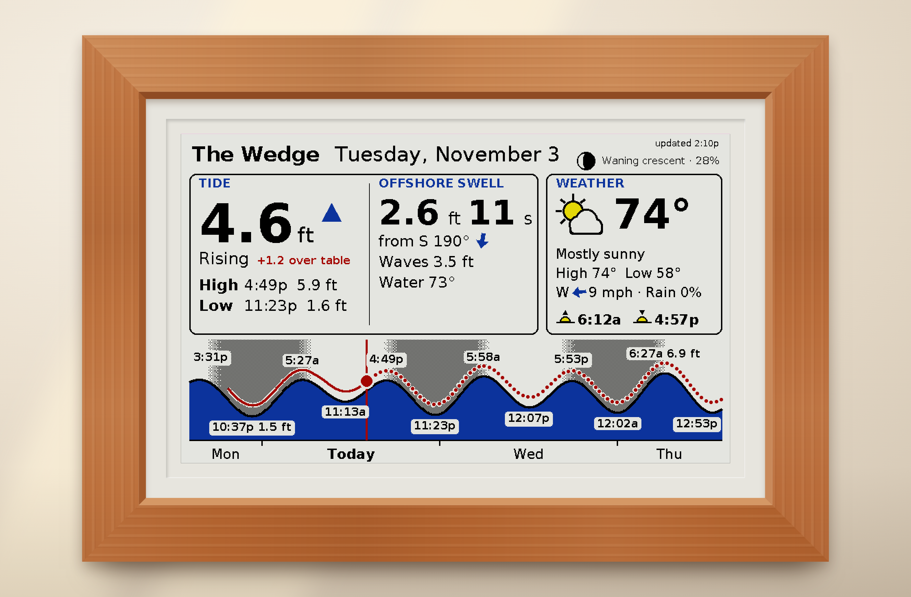
</p>

<h1 align="center">Sea &amp; Sky Ink Frame</h1>

<h3 align="center">A color e-ink frame that shows the tide, the surf, the night sky and your photos.</h3>

<p align="center">
  <a href="#six-screens">Screens</a> ·
  <a href="#the-schedule">Schedule</a> ·
  <a href="#the-dashboard">Dashboard</a> ·
  <a href="#when-the-wi-fi-goes-away">Wi-Fi</a> ·
  <a href="#reliability">Reliability</a> ·
  <a href="#how-it-works">How it works</a> ·
  <a href="#tech-specs">Specs</a> ·
  <a href="#build-your-own">Build your own</a>
</p>

<p align="center"><a href="LICENSE"></a></p>

Sea & Sky Ink Frame is a 7.3-inch color e-paper display in a wood frame, made for a house near the
Wedge in Newport Beach, California. There's no backlight. On the wall it looks like a print, and it
keeps its picture with the power off.

During the day it cycles through six screens: the tide and weather, a nautical chart of Newport Bay,
a woodblock-style picture of today's sea, the sky, one of your photos, and a combination of four of
them. After sunset it shows the night sky as it looks through a south-facing window, with the Moon
and planets where they actually are, redrawn every hour.

It's built to run without anyone looking after it. Behind the screens are a scheduler that follows
sunrise and sunset, a web dashboard, two buttons on the back, a setup hotspot for when the Wi-Fi
changes, battery backup and more than 1,500 tests, all running on a Raspberry Pi Zero 2 W with
512 MB of RAM.

<div align="center">

| **6** | **1,663** | **1,086** | **1,500+** |
|:---:|:---:|:---:|:---:|
| inks | stars | charted depths | tests |

</div>

<sub>The wall in the top picture is a mockup. Everything on the panel in this README was drawn by the frame's own code at the panel's 800 × 480, from real data, most of it recorded on November 3, 2026. The colors are an estimate of the inks, which look more like printed paper than a monitor does.</sub>

---

## Six screens

<table>
  <tr>
    <td align="center" valign="top" width="50%">
      <a href="#the-day-screen"><b>The day screen</b></a><br><br>
      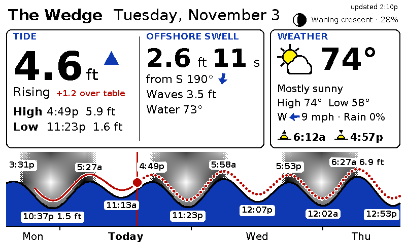<br><br>
      The tide, swell, weather, sun and moon for today.
    </td>
    <td align="center" valign="top" width="50%">
      <a href="#the-night-sky"><b>The night sky</b></a><br><br>
      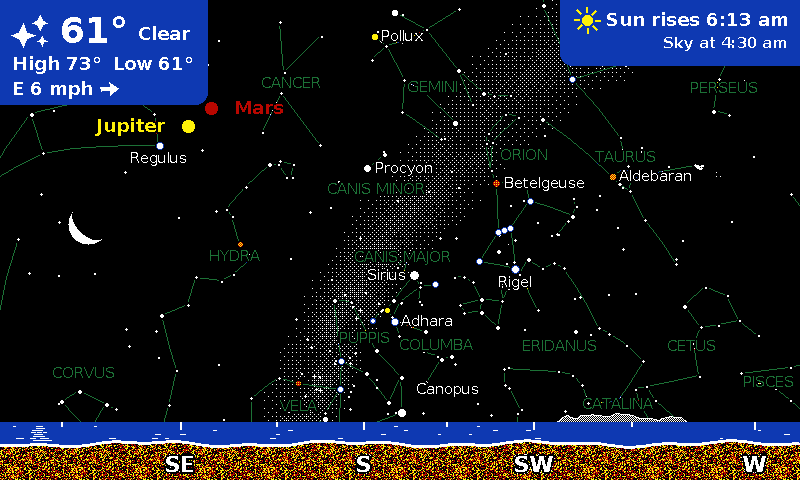<br><br>
      Stars, planets and the Moon in their real positions, seen through a south-facing window.
    </td>
  </tr>
  <tr>
    <td align="center" valign="top" width="50%">
      <a href="#the-sea"><b>The sea</b></a><br><br>
      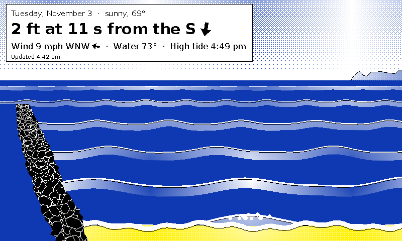<br><br>
      Today's swell, wind and tide, drawn like a woodblock print.
    </td>
    <td align="center" valign="top" width="50%">
      <a href="#the-harbor-chart"><b>The harbor chart</b></a><br><br>
      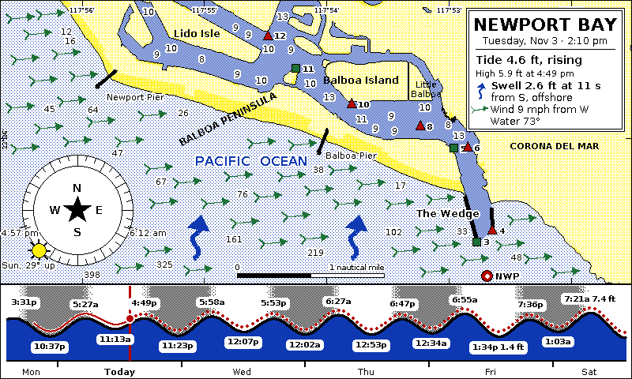<br><br>
      Newport Bay as a nautical chart, with the current wind, swell and tide.
    </td>
  </tr>
  <tr>
    <td align="center" valign="top" width="50%">
      <a href="#your-photos"><b>Your photos</b></a><br><br>
      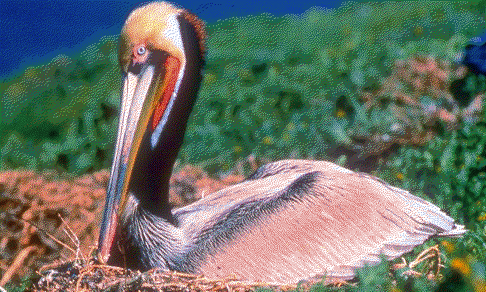<br><br>
      Any photo, dithered into the panel's six inks.
    </td>
    <td align="center" valign="top" width="50%">
      <a href="#the-combo"><b>The combo</b></a><br><br>
      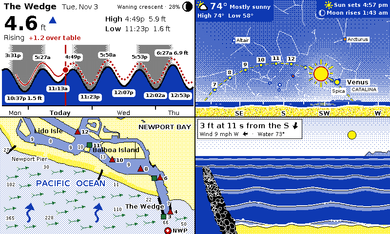<br><br>
      The day screen, sky, harbor and sea together.
    </td>
  </tr>
</table>

---

## The day screen

The screen to check before heading down to the water. The big numbers are sized to read from
across the room.

<p align="center">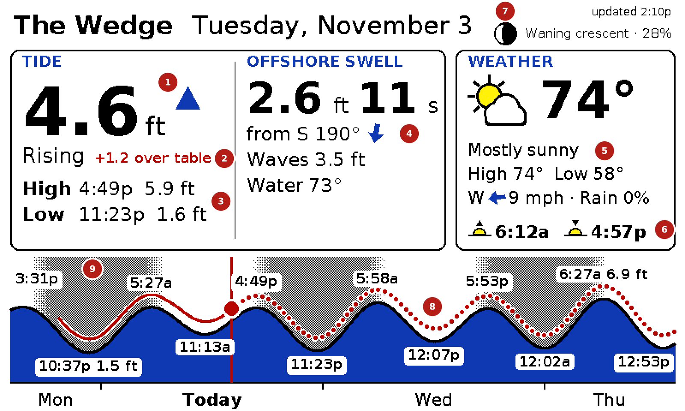</p>

| # | What it shows |
|:---:|---|
| **1** | **The water level now,** and whether it's rising or falling. |
| **2** | **How far the water is running from the tide table,** when the difference is half a foot or more. |
| **3** | **The next high and low,** adjusted by that difference. |
| **4** | **Offshore swell:** height, period and direction. The arrow points the way the swell is moving, as you face the window. |
| **5** | **Weather:** current conditions, today's high and low, wind and chance of rain. |
| **6** | **Sunrise and sunset** for this location and date. |
| **7** | **The Moon's phase,** drawn and named, with the percent illuminated. New moons, full moons and eclipses are also marked on the chart. |
| **8** | **A three-day tide chart.** Blue is the tide table. The red line is the measured water level over the last day, and the red dots are where it's likely to go next. |
| **9** | **Night,** shaded with a fade of dots, so you can see which tides fall after dark. |

### Tide tables only know the Sun and the Moon

Tide predictions come from astronomy alone. Weather and ocean conditions can push the real water
well away from them: in the fall of 2026, Kelvin waves and warm water held the sea more than a foot
above the predictions for weeks.

NOAA's gauge at the Newport Bay entrance stopped reporting in January 1994, so nothing measures the
water at the Wedge today. The frame reads the nearest working gauge, in Los Angeles, 39 km up the
coast, works out how far it's running from its own predictions, and applies that difference to
Newport's. I tested the method against the old Newport gauge records and against recent data:

| How far off, in feet | Tide table alone | With the correction |
|---|:---:|:---:|
| Against Newport's old gauge, 1982, 1983, 1988, 1992 and 1993 (RMS) | 0.23–0.34 | **0.06–0.11** |
| Two days ahead at the Los Angeles gauge, Oct 1–Nov 4, 2026 | 1.28 | **0.21** |

The screen still labels it an estimate. The forecast holds the last 25 hours' difference steady, so
it won't anticipate a storm that hasn't arrived. Readings more than 2 hours old are marked "as of",
and after 12 hours without data the red line is dropped and the chart shows the tide table only.

---

## The night sky

Tonight's sky over the Pacific, computed on the frame for the time it's drawn.

<p align="center">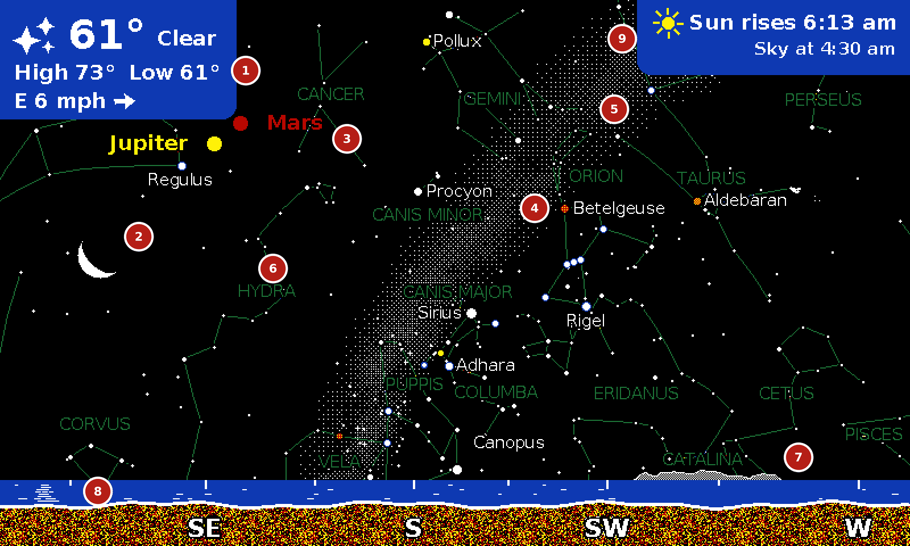</p>

| # | What you're looking at |
|:---:|---|
| **1** | **The weather,** with stars for a clear night and the wind's direction as seen from the window. |
| **2** | **The Moon,** at its real phase and tilt, with Earth's shadow on it during an eclipse. |
| **3** | **The planets** from Mercury to Saturn, labeled in their own colors. Saturn has its rings. |
| **4** | **Stars in their real colors,** from their measured B−V index. Orange Betelgeuse is dithered from red and yellow; hot blue Rigel is white in a blue ring. |
| **5** | **The Milky Way** in fine white dots, from ESO's all-sky panorama. |
| **6** | **All 88 constellations,** in thin green lines with their names. |
| **7** | **Santa Catalina Island** where it sits on the horizon, from elevation data with Earth's curvature and refraction included. It's drawn four times taller than life so it's visible. |
| **8** | **The sea, surf and sand,** with the Moon's reflection on the water and the compass points. |
| **9** | **What's next:** sunrise or sunset, moonrise, and the time this sky was drawn for. |

The view covers 170° of the horizon, from the horizon up to straight overhead, centered on the
window's measured bearing of 190°. Positions come from JPL's DE421 ephemeris and are computed on
the frame with no network connection. The test suite checks them against reference positions from
JPL Horizons.

### A night, sped up

The sky redraws every hour on the wall. This is one evening and night at higher speed, from the
afternoon through dusk and moonrise to dawn. The Milky Way sets in the west as Orion rises in the
east.

<p align="center">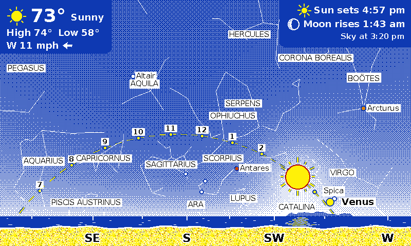</p>

### By day

The same view follows the Sun. In daylight it's a dithered blue sky with the Sun's arc and the hours
marked on it. In the evening a sunset forms along the horizon, then the stars come out, brightest
first.

| Noon | Sunset | Dusk |
|:---:|:---:|:---:|
| 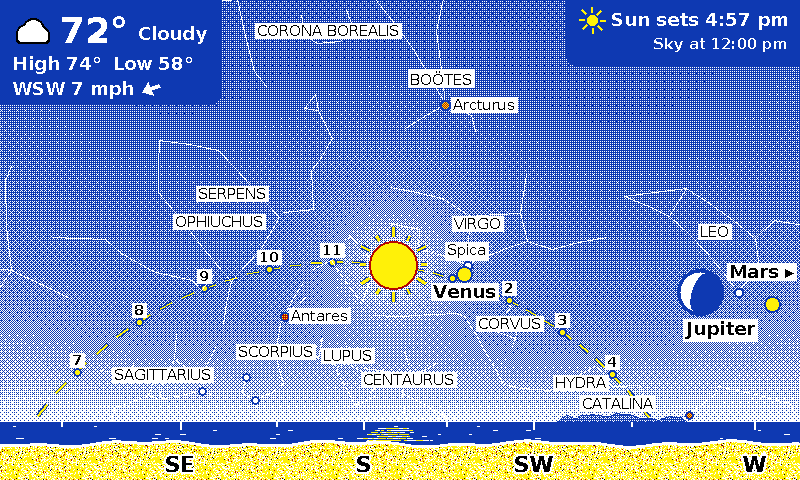 | 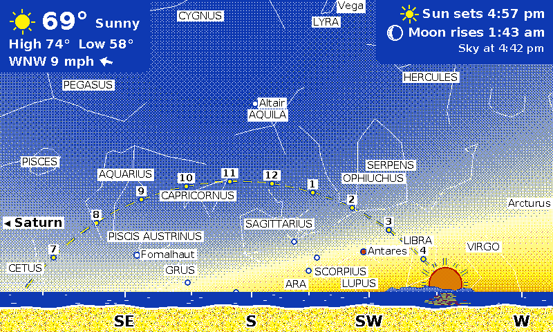 | 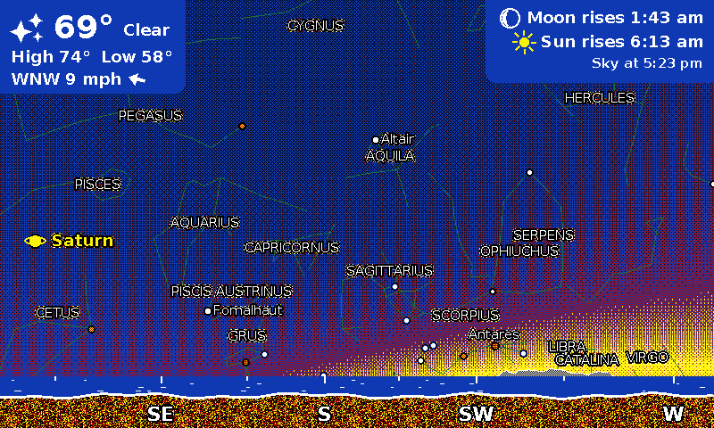 |

| Fall evening | Nearly full Moon | Summer Milky Way |
|:---:|:---:|:---:|
| 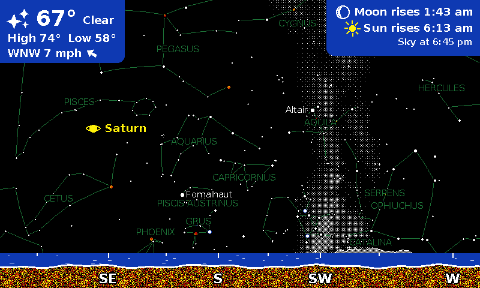 | 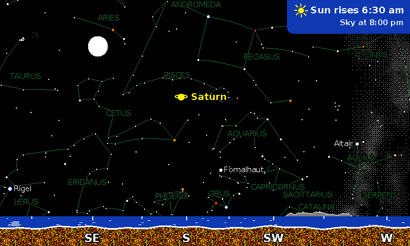 | 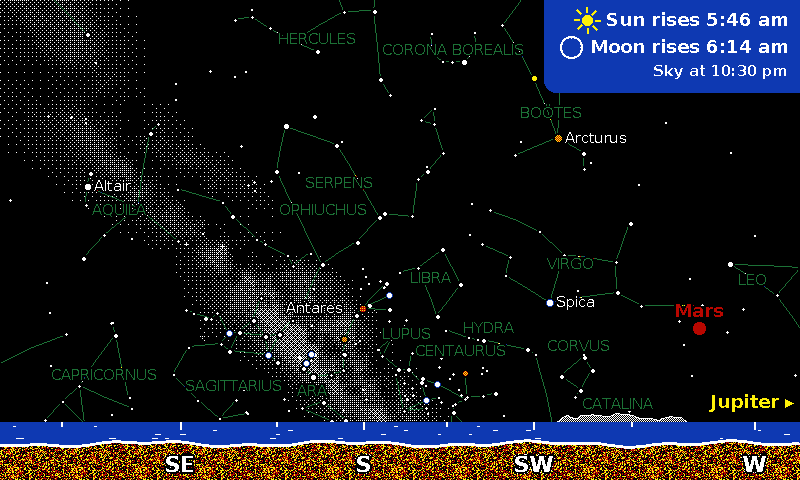 |

### Eclipses

During a lunar eclipse, the frame works out where each pixel of the Moon falls in Earth's shadow.
The faint outer shadow is drawn as white with black dots. The deep shadow is coppery red with a
yellow edge, darker toward the middle, and the Moon's reflection on the water turns red as well. In
a solar eclipse the Moon covers the Sun to scale, from the side it actually approaches.

Any eclipse on Earth is announced in the corner 12 hours ahead, with what will be visible locally,
such as "Total until 4:02 am" or "not seen here". For every eclipse from 2024 through 2027, the
type matches NASA's catalogs and lunar contact times are within 90 seconds. The red of a total
eclipse was checked on the real panel.

| Partial, 2:40 am | Total, 3:30 am | April 8, 2024, 11:12 am |
|:---:|:---:|:---:|
| 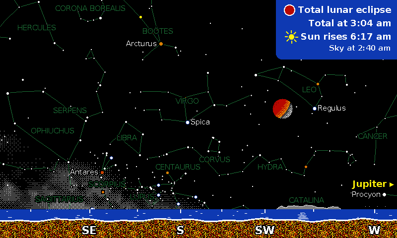 | 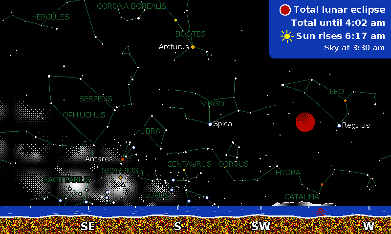 | 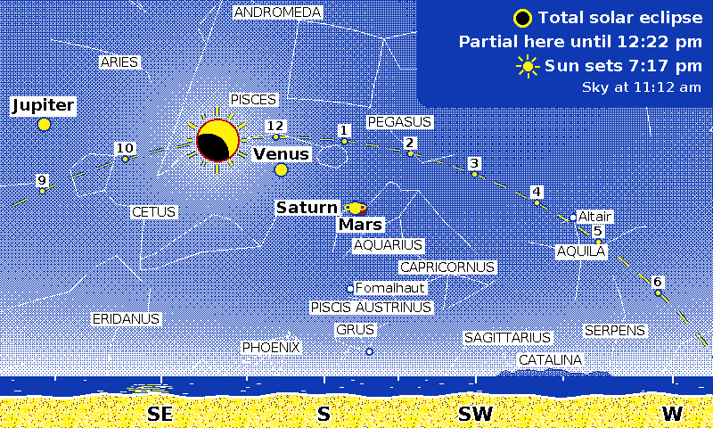 |

<sub>The total lunar eclipse of March 3, 2026, and the solar eclipse of April 8, 2024, which was partial from Newport Beach.</sub>

---

## The sea

The sea screen is a picture rather than a chart, drawn in the style of a woodblock print. Each part
of it comes from the forecast:

| Condition | How it's drawn |
|---|---|
| Swell height | The size of the crests and how much foam they throw |
| Swell period | The spacing between rows of waves |
| Swell direction | The angle of the rows, relative to the window |
| Wind | Chop on the water, and whitecaps from 10 mph |
| Tide | The width of the beach |
| The Sun | A disc at its real bearing and height. After sundown the sea goes dark and the Moon replaces it |

| Calm | Big swell | Windy |
|:---:|:---:|:---:|
| 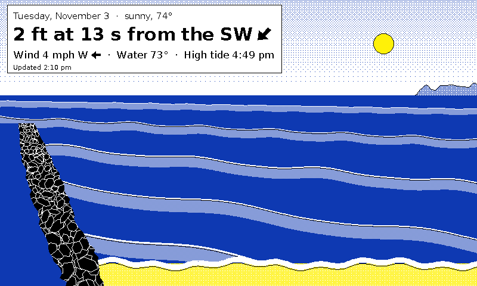 | 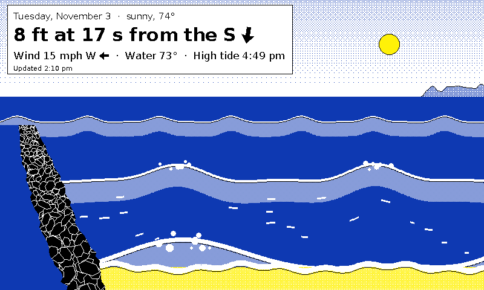 | 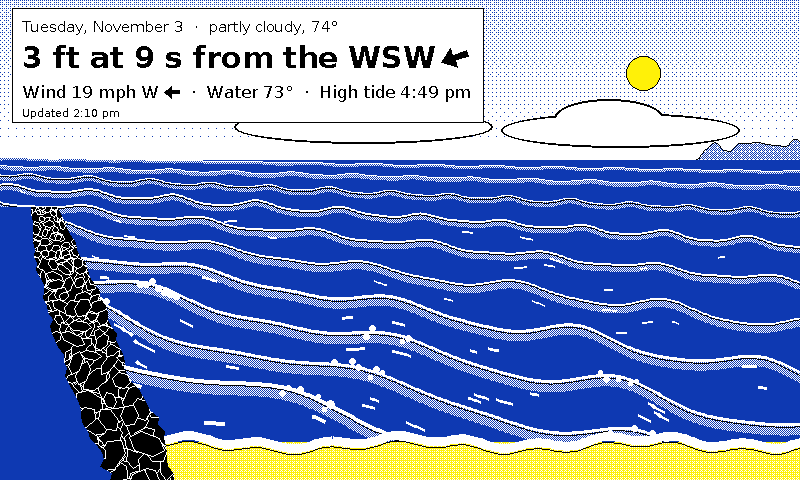 |

| Gale | Sunset | Night |
|:---:|:---:|:---:|
| 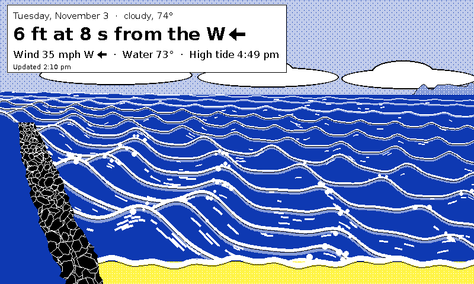 |  | 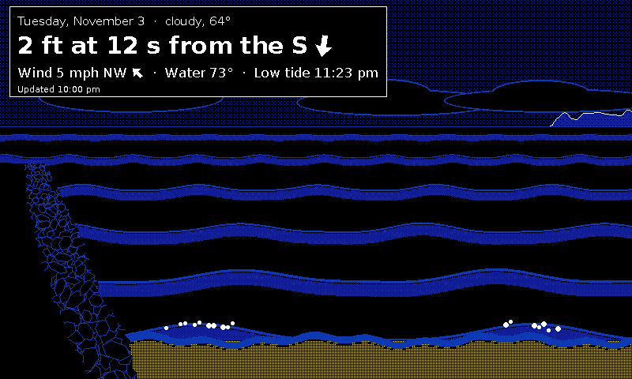 |

<sub>Calm, Big swell, Windy and Gale are preview settings from the dashboard. On the wall, the screen always uses the real forecast.</sub>

---

## The harbor chart

<p align="center"></p>

Lower Newport Bay, north up, from Newport Pier to Corona del Mar. The shoreline, islands, jetties
and numbered channel beacons come from OpenStreetMap. The 1,086 soundings come from NOAA's
electronic navigational charts, in feet below mean lower low water, and none were typed in by hand.
Over the chart it draws current conditions:

- **Wind** as a field of feathered arrows, one feather per 10 mph.
- **Swell** as two wavy blue arrows from the swell's real direction.
- **The Sun and Moon** on the compass rose at their current bearings, with today's sunrise and sunset marked on the rim.
- **The tide,** measured and predicted, in a band along the bottom from yesterday to four days ahead.

---

## Your photos

<p align="center">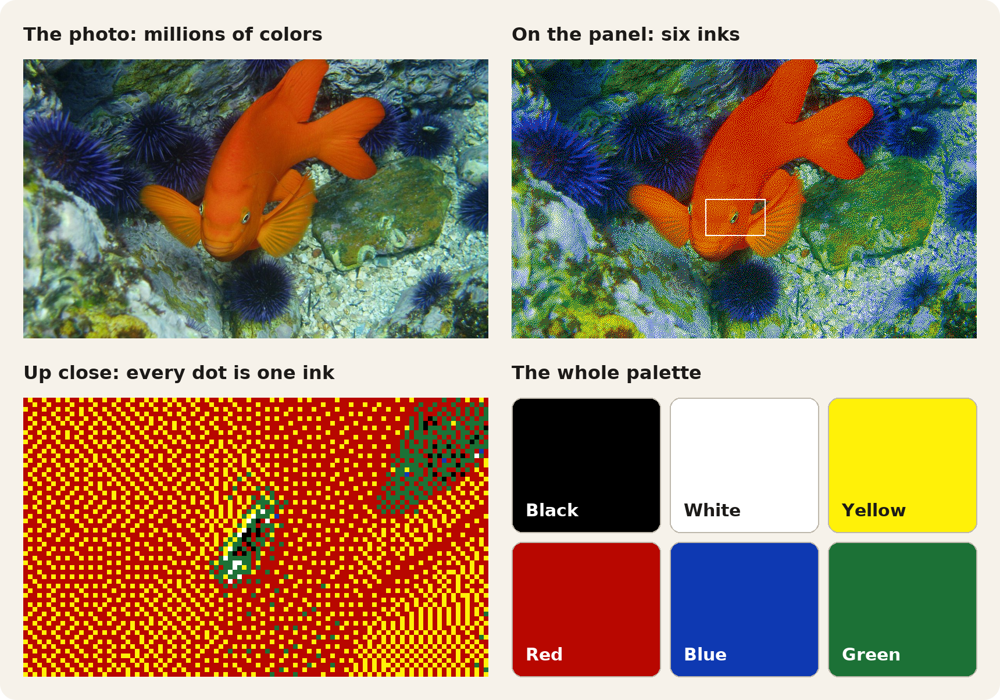</p>

The panel has six pigments and can't mix them, so photos are dithered: dots of different inks are
placed side by side and blend at a distance. From across the room the garibaldi is orange. Up close
it's red and yellow dots.

The color settings (saturation 1.3, vibrance 0.5) were picked by comparing grids of photos on the
panel at different settings, since a monitor can't show what the inks will actually do.

<table>
  <tr>
    <td>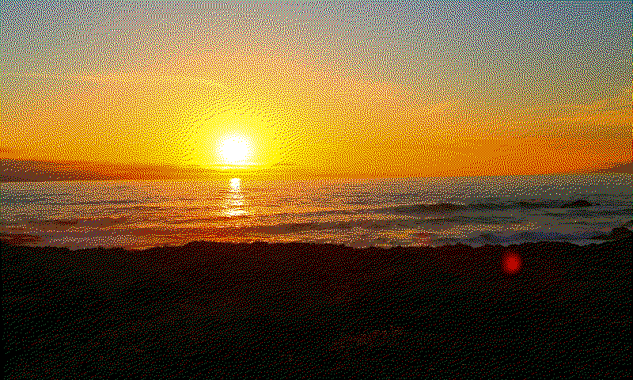</td>
    <td>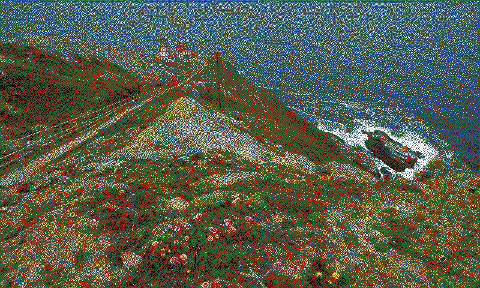</td>
  </tr>
  <tr>
    <td></td>
    <td>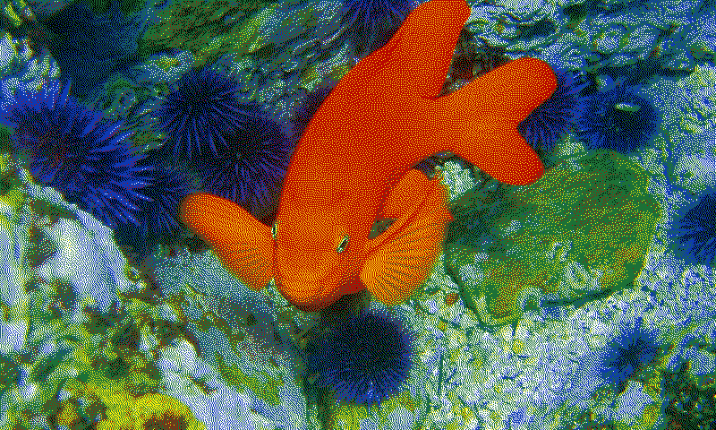</td>
  </tr>
</table>

From the dashboard you can upload photos, drag them into order, queue the one to show next, or put
one on the wall immediately. Deleted photos go to a trash folder rather than being erased.

---

## The combo

<p align="center"></p>

The day screen, sky, harbor and sea in four quarters. Each quarter is drawn from scratch at its
smaller size. Shrinking a dithered image would merge its dots into solid blocks of ink.

---

## The schedule

The frame switches between day and night at sunrise and sunset. By default, each daylight hour
shows every screen for ten minutes:

| :00 | :10 | :20 | :30 | :40 | :50 |
|:---:|:---:|:---:|:---:|:---:|:---:|
| A photo | The day screen | The harbor chart | The sky | The sea | The combo |

After sunset it shows the night sky only, redrawn once an hour.

- Whatever is on the wall during the day was drawn in the last ten minutes, with the latest tide, weather and swell.
- Each hour starts with a new photo and ends with the combo.
- At night only the sky changes, once an hour. Nobody is watching the panel at 3 am, so there's no reason to refresh it more.
- The cost is six refreshes an hour during the day, each about 30 seconds of flashing. Twenty minutes per screen would halve that.

Here is one real day on the default schedule, minute by minute, from the scheduling code:

<p align="center">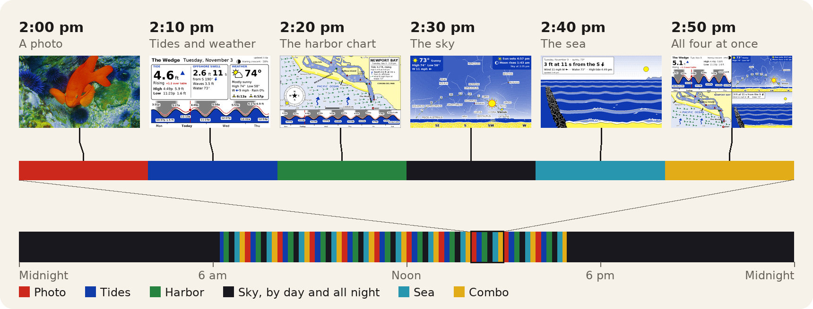</p>

Both rotations can be changed on the dashboard: any screens, in any order, from 3 minutes to 24
hours each. A single 60-minute photo step makes a slideshow. Quiet hours stop scheduled changes
overnight.

---

## The dashboard

<p align="center">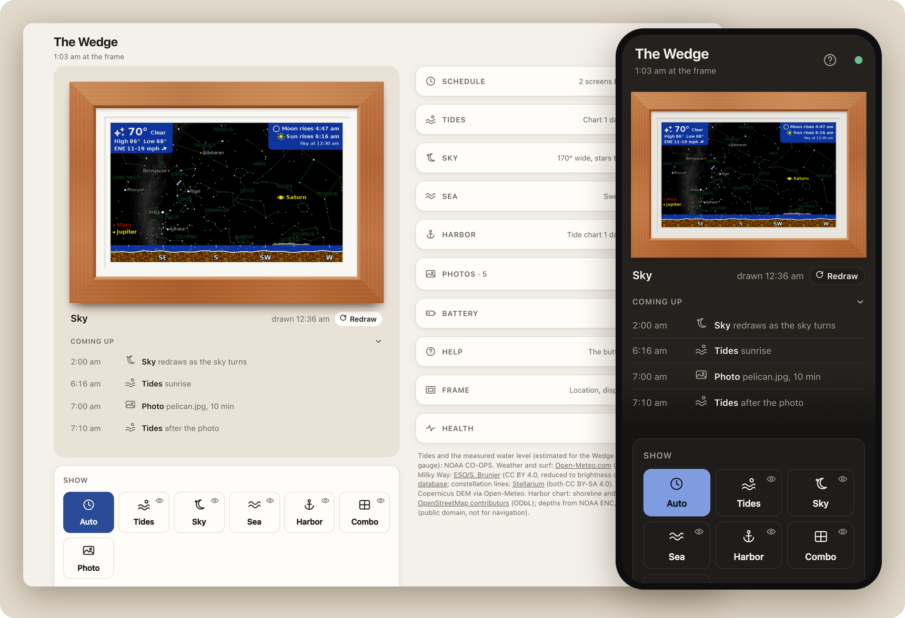</p>

The frame serves its own web dashboard. It's designed for a phone and switches to two columns on a
laptop. There's no app, account or cloud service, and with [Tailscale](https://tailscale.com) it
works away from home too.

- **What's on the wall,** shown in the frame in the panel's colors. The page updates when the panel refreshes.
- **What's coming up,** with the reason for each change, like "Sky redraws as the sky turns".
- **Show any screen now,** or return to the schedule.
- **Previews** of any screen for any time, including settings you haven't saved yet: next Tuesday's sunrise, or the sea in a gale at sunset. Previews stay on the page and never reach the panel.
- **Every setting,** grouped by screen. Invalid values are rejected before they're saved.
- **Frame name and Wi-Fi networks,** so you can set it up for a new home before you move it.
- **Help,** with a labeled drawing of the back of the frame and what each button does.
- **Health:** a green dot when everything's working, and details on Wi-Fi, clock, CPU temperature, memory and data sources when something isn't.

<p align="center">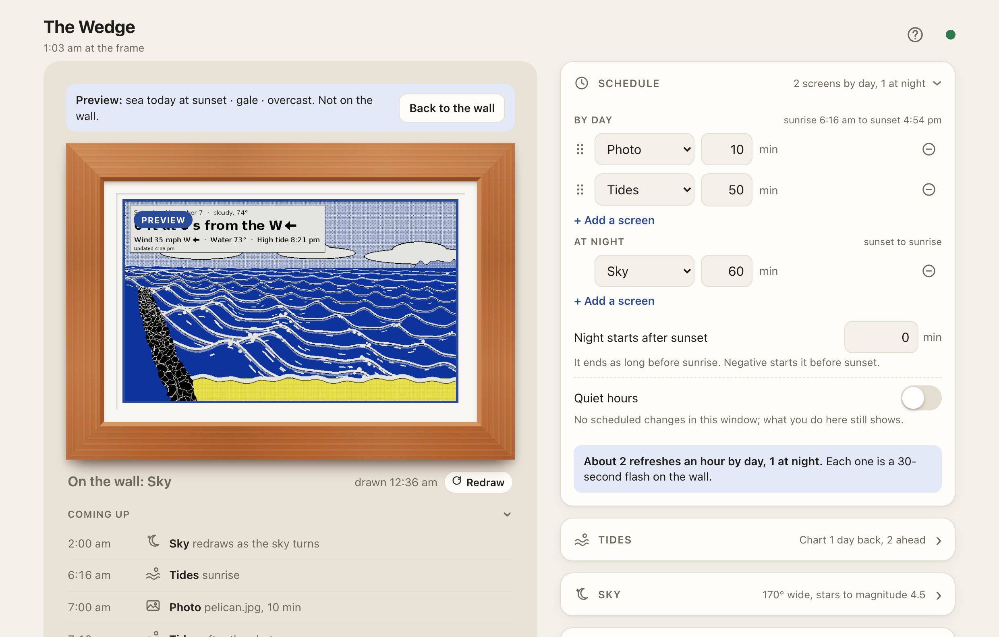</p>

<p align="center"><sub>Previewing the sea at sunset in a gale.</sub></p>

<table>
  <tr>
    <td align="center" valign="top" width="33%"><b>Photos</b><br><br>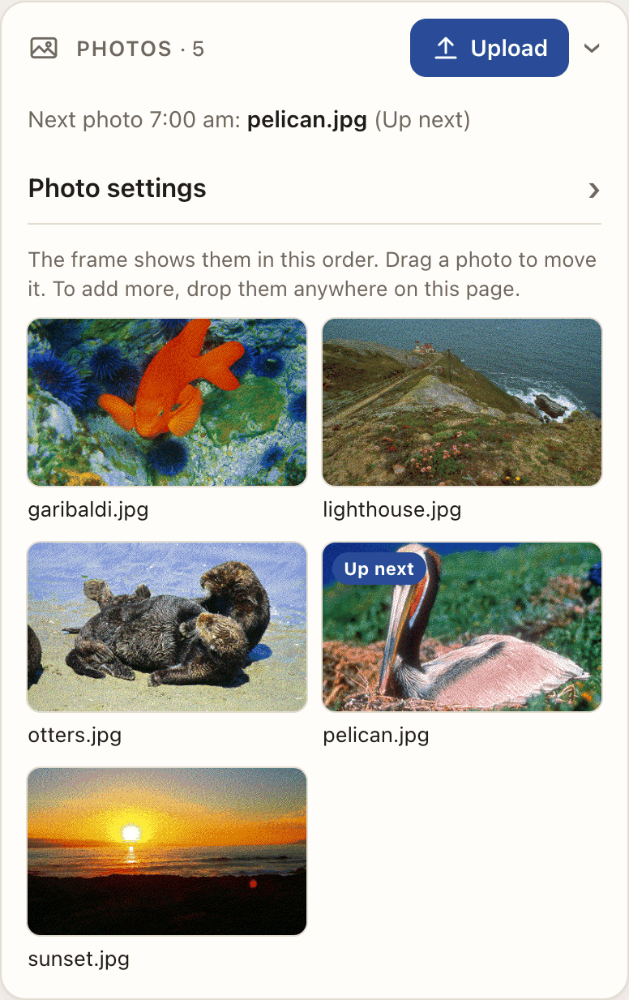<br><br>Drag to reorder. Each tile is dithered the way the panel will show it.</td>
    <td align="center" valign="top" width="33%"><b>Schedule</b><br><br>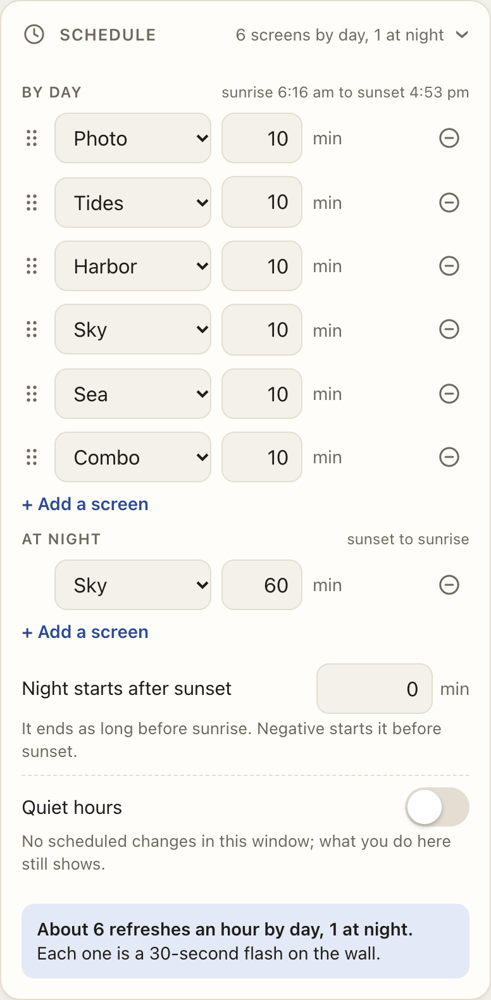<br><br>Drag steps to reorder. It shows how many refreshes an hour the plan costs.</td>
    <td align="center" valign="top" width="33%"><b>Battery</b><br><br>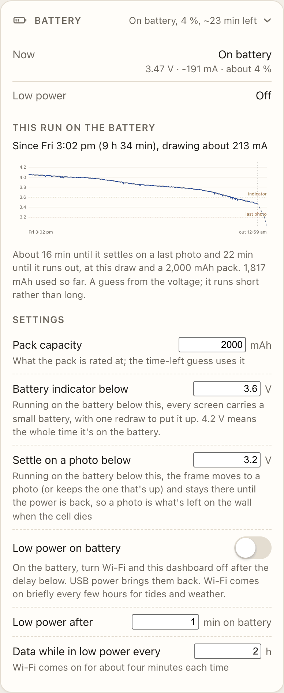<br><br>A real discharge on 2,000 mAh, 9 h 34 min in.</td>
  </tr>
</table>

---

## Two buttons on the back

The everyday controls, for anyone without the dashboard open.

| Press | What it does |
|---|---|
| **Forward** or **back** | The next or previous screen in today's rotation, which then continues from there |
| **Hold forward** for a second | Photos only, day and night, with the buttons flipping through them. Hold again to go back to the schedule |
| **Hold back** for a second | [Wi-Fi setup](#when-the-wi-fi-goes-away), when the frame has lost its network. With Wi-Fi working, it only clears a leftover mark |
| **Hold both** for a second | Low power on or off, for when the frame is running on its battery |

The buttons run as their own small service, so they still work when low power mode has turned the
dashboard off. They're wired to a header that's already on the board, with no soldering to the Pi.
The dashboard's Help box shows where they are:

<p align="center">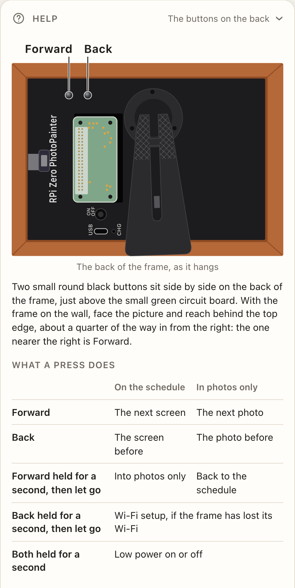</p>

## When the Wi-Fi goes away

<p align="center">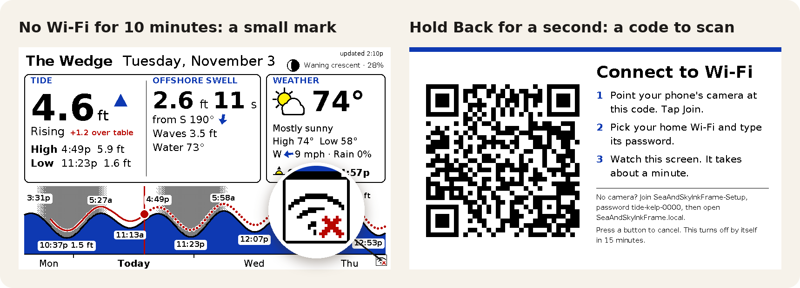</p>

If the Wi-Fi drops, the frame keeps going. Tides are cached for at least two weeks, and the sky and
photos are stored on the frame, so every screen still works. It reconnects on its own when the
network comes back. After 10 minutes offline, the next screen it draws carries a small Wi-Fi mark
with a red X, which goes away at the first redraw once it's back online. The mark never triggers a
refresh of its own. It doesn't appear when the router is up but the internet is down, or in low
power mode, where Wi-Fi is turned off deliberately.

If the network changes for good, with a new router, a new password or a move, the frame can't
reconnect without help. **Hold Back for a second** and it starts its own hotspot with a new
password and shows a QR code. Scan it, tap Join, and the setup page lists the networks the frame
can see.

<p align="center">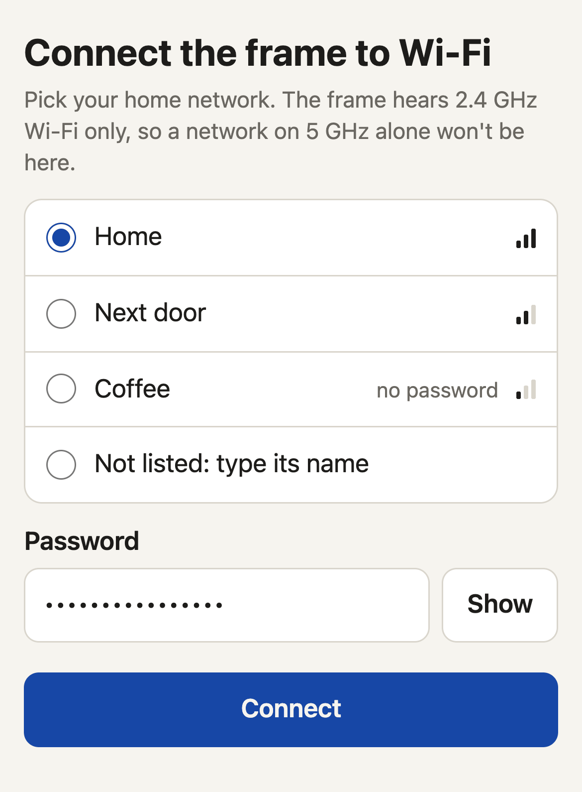</p>

- **It only starts when you hold the button.** An outage should never require a QR code, and the frame can't search for its home network while its own hotspot is running.
- **A wrong password isn't saved.** The frame has one radio, so the phone disconnects while it tries the new network, and the result appears on the panel. A network is saved only after it connects. Otherwise the hotspot comes back with the reason.
- **It shuts off** when any button is pressed, or 15 minutes after the setup page was last open.
- **The setup screen can carry a note,** such as who to call, set from the dashboard.

---

## Reliability

The frame is meant to hang in a home where nobody should ever need a laptop or SSH to keep it
running.

| When this happens | What the frame does |
|---|---|
| **The Wi-Fi goes out** | Keeps running from its caches, which hold at least two weeks of tides, and reconnects when the network is back. A small mark appears after 10 minutes. Weather more than 12 hours old is left off the screen |
| **The Wi-Fi changes for good** | Hold Back for a second, scan the code and pick the network |
| **A data source goes down** | Keeps the last good data and retries every 5 minutes |
| **The power goes out** | The picture stays on the panel with no power at all. With a battery fitted, the frame keeps running |
| **The power comes back** | Boots and returns to the right screen. It keeps the old picture until the network sets the clock. If that takes more than 10 minutes, it shows photos, the one screen that doesn't depend on the time, and shows "Clock not set" only if there are no photos |
| **The battery runs low** | Every screen gets a small battery mark. Then it switches to a photo, so a photo is what stays on the wall when the battery dies |
| **The battery runs out** | **It never shuts itself down.** A halted Pi stays off until someone finds the switch, so a flat battery is treated like any other power cut, and the frame boots when power returns |
| **Someone saves a bad setting** | The dashboard rejects it. A corrupted settings file falls back to the defaults |
| **The panel hangs** | A refresh that takes more than 180 seconds is stopped with an error. After every refresh, including failed ones, the panel goes into deep sleep with its power cut |

---

## How it works

A systemd timer runs one short program, `photopainter tick`, at the start of every minute.

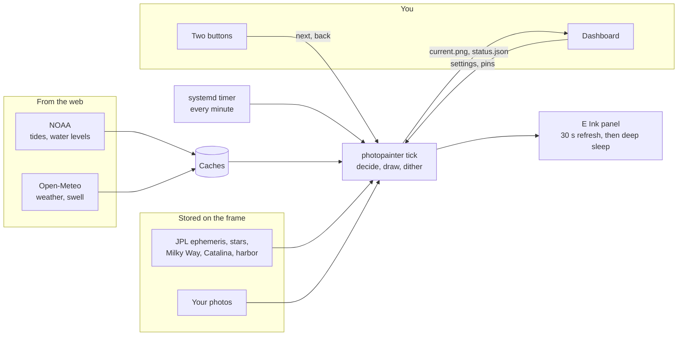

Each tick:

1. **Checks the clock.** The Pi has no battery-backed clock, so the frame doesn't trust the time until the network has set it.
2. **Refreshes data that's due:** tides daily, the water level every 30 minutes, weather and swell hourly. A failed fetch keeps the old cache and never stops the tick.
3. **Decides what to show.** `schedule.decide()` is a pure function: the time, settings, overrides and sun times go in, and the screen to show comes out.
4. **Stops if nothing has changed,** which is what most ticks do. They finish without loading the ephemeris.
5. **Draws the screen** as a grid of ink numbers, one per pixel.
6. **Refreshes the panel** over SPI, about 30 seconds of flashing, then puts the panel into deep sleep and cuts its power.
7. **Saves `current.png` and `status.json`,** so the dashboard shows exactly what's on the wall.

The dashboard and the buttons never drive the panel directly. They write a small file and start a
tick, so only one process ever talks to the panel, under a single lock.

### Drawing in inks

Charts and text aren't dithered. Screens draw on an `InkCanvas`, whose pixels are ink numbers rather
than colors, with no anti-aliasing. Every screen is checked for its size and inks before it's sent,
so an off-palette pixel can't reach the panel. Small text stays sharp, and the dashboard's preview
matches the panel exactly.

```
photo → EXIF rotate → fit to 800 × 480 → color → Floyd–Steinberg dither ─┐
                                                                         ├→ ink numbers 0–5
chart → InkCanvas: lines, text, ordered dots ────────────────────────────┘
      → rotate to the panel's 480 rows × 800 columns → panel codes → 4 bits a pixel → 192,000 bytes
```

### Light enough for a Pi Zero

It runs in 512 MB of RAM with no virtualenv, using only Python packages from Debian's apt. Measured
on the Pi:

| Job | Cost |
|---|---|
| Drawing the sky from a cold start | 4.1–4.7 s, 79 MB peak |
| A full panel refresh | About 30 s |
| Watching the buttons | About 32 MB, 0.3 % of a core |
| Running from the battery | About 0.2 A (0.8 W) |

The 1,500+ tests run on a Mac with fake hardware and recorded data. None of them need the frame or
the network.

### Where the data comes from

| What | Source | Refreshed | API key |
|---|---|:---:|:---:|
| Tide predictions | NOAA CO-OPS, station 9410580 (Newport Bay Entrance) | Daily | None |
| Measured water level | NOAA CO-OPS, station 9410660 (Los Angeles) | 30 min | None |
| Weather | Open-Meteo forecast | Hourly | None |
| Swell, waves, sea temperature | Open-Meteo marine | Hourly | None |
| Sun, Moon, planets, stars | Computed on the frame with [Skyfield](https://rhodesmill.org/skyfield/) and JPL DE421 | Never needs the network | None |

---

## Tech specs

| Part | Spec |
|---|---|
| **Display** | 7.3-inch E Ink Spectra 6, 800 × 480 |
| **Inks** | Black, white, yellow, red, blue, green |
| **Refresh** | About 30 s, full screen. The panel holds its picture with no power |
| **Computer** | Raspberry Pi Zero 2 W: 4 × Cortex-A53, 512 MB RAM, 2.4 GHz Wi-Fi |
| **Frame** | [Waveshare RPi Zero PhotoPainter](https://www.waveshare.com/wiki/RPi_Zero_PhotoPainter) |
| **Power** | USB, plugged in. Optional single-cell 3.7 V Li-ion as a backup |
| **Battery backup** | 10 h 42 min on a 2,000 mAh pack in its first full run-down. Optional low-power mode for about a third more |
| **Controls** | Two buttons, plus a web dashboard on port 80 |
| **Software** | Python 3.13, Pillow, NumPy, Skyfield, Flask |
| **Network** | Wi-Fi, with [Tailscale](https://tailscale.com) for remote access and its own setup hotspot |
| **Accounts and subscriptions** | None |

---

## Try it without the frame

Everything except the panel driver runs on a Mac, with fake hardware and recorded data.

```bash
python3 -m venv .venv && .venv/bin/pip install -e '.[dev]'
scripts/fetch-ephemeris.sh
.venv/bin/pytest
```

Draw any screen for any moment:

```bash
PHOTOPAINTER_STATE_DIR=tests/fixtures \
  .venv/bin/photopainter scene tides --at 2026-11-03T14:10 -o previews/day.png
.venv/bin/photopainter scene sky --at 2027-07-03T22:30 -o previews/sky.png
.venv/bin/photopainter preview photos/your-photo.jpg
```

Run the dashboard with a simulated panel:

```bash
S=/tmp/pp-web; mkdir -p $S/photos && cp tests/fixtures/{tides,weather,surf,gauge}.json $S/
echo '{"photos": {"folder": "'$S/photos'"}}' > $S/config.json
PHOTOPAINTER_STATE_DIR=$S PHOTOPAINTER_CONFIG=$S/config.json SSL_CERT_FILE=/etc/ssl/cert.pem \
  .venv/bin/photopainter serve --fake-panel --host 127.0.0.1 --port 8742
```

Then open <http://127.0.0.1:8742>. Every picture in this README can be redrawn with
`.venv/bin/python scripts/build-readme-images.py`.

---

## Build your own

This frame isn't for sale, and the weather data it uses is licensed for non-commercial use only.
The hardware is off the shelf, though, and everything needed to build one is in this repo.

**You'll need:**

- A Waveshare **`RPi-Zero2W-PhotoPainter`**, the frame with a Pi Zero 2 W already inside. Waveshare's RP2040 and ESP32-S3 PhotoPainters are different boards and won't run this.
- A microSD card and a USB power supply.
- *Optional:* a single-cell 3.7 V Li-ion pack. **Check its polarity against the board before plugging it in.** My first pack came wired backward, and nothing on the board survives a reversed cell.
- *Optional:* two push buttons, wired to the P1 header. See [docs/hardware.md](docs/hardware.md).

**Then:**

1. Flash the card with `scripts/flash-sd.sh`, following [docs/pi-setup.md](docs/pi-setup.md).
2. Run `scripts/fetch-ephemeris.sh`, then `scripts/deploy.sh`, to put the code on the Pi.
3. Start it:

   ```bash
   ssh photopainter sudo systemctl enable --now photopainter-tick.timer photopainter-web.service
   ```

   If you wired up buttons, also enable `photopainter-buttons.service`.

4. Open the dashboard at `http://<your-frame>.local`, add some photos and hang it up.
5. To reach it from anywhere, [add Tailscale](docs/pi-setup.md#remote-access-tailscale).

**Somewhere other than Newport Beach:** the tides, water level, weather, sky and window bearing all
come from settings. The harbor chart, Catalina's skyline and the sea screen's jetty are specific to
Newport. They're built by `scripts/build-harbor.py`, `scripts/build-skyline.py` and `scenes/sea.py`,
and another coastline would need its own versions.

---

## Limitations

- **It's slow.** A refresh takes about 30 seconds and the screen flashes while it happens. There's no partial refresh.
- **The battery is a backup only.** The board can't wake the Pi on a schedule, so the frame stays plugged in and the battery covers power cuts.
- **The swell is offshore.** It comes from a wave model off Newport and isn't a surf report for the Wedge.
- **The water level is an estimate** from a gauge 39 km away, and it can't anticipate a storm.
- **The dashboard has no login.** It's meant for your home network and your own tailnet. Don't port-forward it or expose it with Tailscale Funnel.
- **The harbor chart is not for navigation.**
- **The clock needs the network after a power cut** until an RTC coin cell is fitted.
- **Wi-Fi setup is new.** On the frame, the QR code was up 39 seconds after the button was held, and an Android phone joined from it. An iPhone, and joining a network from the setup page, haven't been tested yet.

---

## Credits

**Data.** Weather data by [Open-Meteo.com](https://open-meteo.com/) (CC BY 4.0). Tides and water levels from [NOAA CO-OPS](https://tidesandcurrents.noaa.gov/). Chart depths from NOAA ENC. Shoreline, piers and channel marks © [OpenStreetMap](https://www.openstreetmap.org/copyright) contributors (ODbL). Milky Way: ESO/S. Brunier (CC BY 4.0). Stars: the [HYG database](https://codeberg.org/astronexus/hyg) (CC BY-SA 4.0). Constellation lines: [Stellarium](https://stellarium.org) (CC BY-SA 4.0). Catalina's skyline: Copernicus DEM GLO-90, © DLR e.V. 2010-2014 and © Airbus Defence and Space GmbH 2014-2018, provided under COPERNICUS by the European Union and ESA. Ephemeris: JPL DE421. Font: DejaVu Sans. Details and licenses are in [data/README.md](data/README.md).

**Sample photos,** all public domain, from US government agencies, via Wikimedia Commons: [garibaldi](https://commons.wikimedia.org/wiki/File:CINMS_-_Garibaldi_(33029439733).jpg) by Claire Fackler, NOAA; [California brown pelican](https://commons.wikimedia.org/wiki/File:Anacapa-California-Brown-Pelican.jpg), National Park Service; [sunset at Piedras Blancas](https://commons.wikimedia.org/wiki/File:Sunset_over_the_Pacific_Ocean_and_the_California_Coastal_National_Monument_viewed_from_the_Piedras_Blancas_Light_Station_Outstanding_Natural_Area_(18466649940).jpg), Bureau of Land Management; [Point Reyes Lighthouse](https://commons.wikimedia.org/wiki/File:Point_Reyes_Lighthouse_3.jpg), National Park Service; [sea otters](https://commons.wikimedia.org/wiki/File:Playful_sea_otters_(48750234832).jpg) by Lilian Carswell, USFWS.

**Hardware and driver** by [Waveshare](https://www.waveshare.com/). Sea & Sky Ink Frame is an independent project and not a Waveshare product.

**More detail:** [PRD.md](PRD.md) has the plan and the reasoning behind each decision, [CLAUDE.md](CLAUDE.md) covers how the repo works day to day, and [docs/hardware.md](docs/hardware.md) has the pin map, the palette and the driver's quirks.

---

## License

The code, documentation and pictures are licensed under [CC BY-NC-SA 4.0](LICENSE). You can
copy, change and share them with credit, for non-commercial purposes, as long as anything you
share that's built from them uses the same license. For commercial use, open an issue to ask.

The data in `data/`, the Waveshare driver and the sample photos keep their own licenses, listed in
[LICENSE](LICENSE) and [data/README.md](data/README.md). The weather comes from Open-Meteo, which
is free for non-commercial use only, so anyone running the frame is bound by its terms too.
