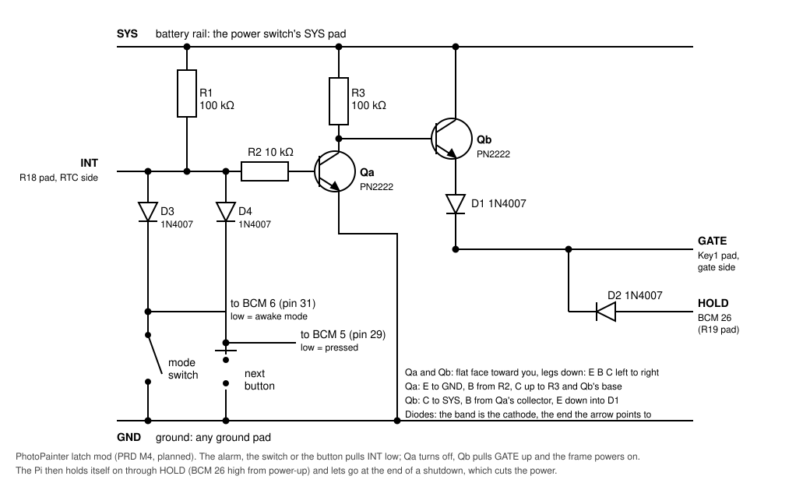
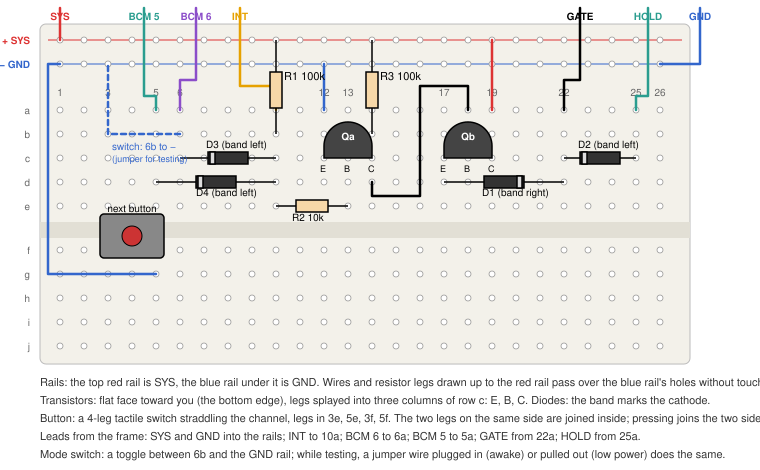

# Hardware reference: Waveshare RPi Zero PhotoPainter

Facts below come from Waveshare's wiki, product page and demo repo (sources at the end),
checked November 2026. Anything marked **Unverified** has not been confirmed on our unit.

**Model:** `RPi-Zero2W-PhotoPainter` (frame with a Pi Zero 2 WHC preinstalled). The
`RPi-Zero-PhotoPainter-ACCE` is the same frame without the Pi. Waveshare's other
"PhotoPainter" products (RP2040 and ESP32-S3 based) are different boards that have no Pi
and no 40-pin header. Their docs and code do not apply here.

## Display

| Item | Value |
|---|---|
| Panel | 7.3" E Ink Spectra 6 (E6), Waveshare "7.3inch e-Paper (E)" |
| Driver | `epd7in3e` (Python `epd7in3e.py`, C `EPD_7in3e.c`) |
| Resolution | 800 × 480 landscape (the driver also accepts 480 × 800 and rotates it) |
| Colors | 6: black, white, yellow, red, blue, green |
| Frame buffer | 4 bits per pixel, 192,000 bytes |
| Full refresh | About **30 s measured on our unit** (Waveshare says 12 s). The panel flickers during refresh, which is normal |
| Partial refresh | Not supported |
| Without power | Keeps showing the last image |

### Palette (driver values)

| Nibble | Color | RGB used by driver |
|---|---|---|
| `0x0` | black | (0, 0, 0) |
| `0x1` | white | (255, 255, 255) |
| `0x2` | yellow | (255, 255, 0) |
| `0x3` | red | (255, 0, 0) |
| `0x4` | unused (orange on other panels; disabled in this driver) | n/a |
| `0x5` | blue | (0, 0, 255) |
| `0x6` | green | (0, 255, 0) |

These are nominal values. The real inks look much duller than pure RGB. Dithering against
measured colors, then writing the matching nibble, should look better than dithering
against the nominal values (to be tested).

### Driver behavior to know

- `getbuffer()` only handles 800×480 or 480×800 images. Any other size logs a warning and
  then crashes (`image_temp` is undefined).
- The stock `getbuffer()` maps colors with Pillow `quantize(palette=...)`, which uses
  Pillow's default dithering.
- `sleep()` sends deep sleep (`0x07`, `0xA5`), waits 2 s, then calls `module_exit()`,
  which releases SPI and GPIO and turns off the display PWR pin. Call `init()` again before
  the next refresh. `init()` includes a hardware reset.
- BUSY reads 0 while busy and 1 when idle.
- The header comment in `epd7in3e.py` says `epd7in3f.py`. That is a copy-paste leftover
  with no effect.
- If the image comes out upside down, rotate it 180° in software.

## Pins and buses

| Signal | Function | BCM | Physical pin |
|---|---|---|---|
| DIN | SPI0 MOSI | 10 | 19 |
| CLK | SPI0 SCLK | 11 | 23 |
| CS | SPI0 CE0 | 8 | 24 |
| DC | data/command | 25 | 22 |
| RST | reset | 17 | 11 |
| BUSY | busy input | 24 | 18 |
| **PWR** | display power enable | **27** | 13 |

PWR on BCM 27 is specific to this board. Generic Waveshare e-Paper HAT demos use a
different pin, so use the pin map from the PhotoPainter repo, not the general
`waveshareteam/e-Paper` repo.

I2C bus 1 (SDA = BCM 2, SCL = BCM 3):

| Device | Address | Notes |
|---|---|---|
| INA219 (battery/UPS monitor) | `0x43` | Waveshare's demo uses 0x43; the class default is 0x40 |
| DS3231 (RTC) | `0x68` | |

Enable both buses with `sudo raspi-config` (Interface Options), or run
`sudo raspi-config nonint do_spi 0` and `sudo raspi-config nonint do_i2c 0`. On current
Raspberry Pi OS the config file is `/boot/firmware/config.txt`. The Waveshare wiki still
says `/boot/config.txt`, which is the older location.

## Buttons

The board has no spare button. Key1 is the power switch. Its schematic draws KEY1 (header pin 29,
BCM 5) and KEY2 (pin 31, BCM 6), each to ground through 100 Ω, but that block is greyed out, those
header pins are marked no-connect and the PCB page has no pads for it (read 2026-11-06). LED1 and
LED2 (pins 32 and 33) are drawn the same way.

P1, the 3-pin header on the edge by the USB-C socket, is fitted on our unit (seen 2026-11-06), so
two buttons need no soldering on the board or the Pi:

| Button | One corner | The diagonally opposite corner |
|---|---|---|
| Forward | P1 `RXD` (BCM 15, header pin 10) | P1 `GND` |
| Back | P1 `TXD` (BCM 14, header pin 8) | P1 `GND`, joined at either button |

- On the frame (the Owner, 2026-11-07): 6 mm black buttons 15 mm apart, side by side just above the Pi as
  you look at the back of it hanging, Forward on the left, about 25 mm below the top edge and 45 and 60 mm
  in from the left of a frame 216 mm wide (measured from a photo). So from the front they're behind the top
  edge, about a quarter of the way in from the right, Forward nearer the right. The dashboard's Help box
  draws them. The plate's printing reads sideways as the frame hangs.
- Back held for a second, then let go, starts Wi-Fi setup when the frame has no Wi-Fi (`hotspot.py`).
- With the board's silkscreen upright and the USB-C socket on the left, P1 reads `GND`, `TXD`, `RXD`
  from the top, so `GND` is nearest the socket.
- On a 4-leg switch, diagonal corners are always a pair the button connects, whichever way it's turned.
- The serial port is off on the Pi (no `enable_uart`, and `pinctrl` shows both pins as inputs), which
  is what makes them free. **Keep it off with a button on `TXD`:** it would become an output, and
  pressing the button would short it to ground.
- Checked on the Pi on 2026-11-06: BCM 5, 6, 14 and 15 each follow the pull they're given, so nothing
  on the board holds them; through lgpio with pull-ups, BCM 14 and 15 read 1 with nothing pressed. Wired
  the same night, and the journal shows real presses of both buttons, and of both held, working.
- A third button would go on BCM 5 (header pin 29, one solder joint on the Pi) and needs code: today
  a long press of forward and holding both are the other actions.

## Power

The wiring below is from the board schematic (under [Sources](#sources); read 2026-11-04).

- USB-C provides 5 V for power and battery charging. An optional single-cell 3.7 V Li-ion
  pack (1500 mAh suggested) plugs into J2, a PH2.0 connector: **pin 1 is +, pin 2 is GND.**
  The silkscreen says so: with the board's text the right way up (USB-C on the left, the
  Pi along the top), J2 sits at the bottom edge left of center, marked `BAT` with **+ on
  the left and − on the right**. Check a pack's red wire lands on + before plugging it in:
  packs with this connector come wired both ways, and nothing on the board protects
  against a reversed cell. The first pack (JLJLUP LP103450, 2000 mAh, 2026-11-05) came
  reversed; the Owner pulled the two crimps out of the plug and swapped them.
- Power path: VBUS → ETA6003 charger (`IN`) → its `SYS` rail (from USB when present, else
  the cell) → Q5, a P-FET switched only by the **power switch** (Key1) → SCT12A0 boost →
  5 V → the Pi's 5 V pins, the panel's 3.3 V regulator (U4, enabled by PWR on BCM 27) and
  the 3.3 V regulator for the RTC and INA219 (U3). Everything goes through the switch and
  the boost, on USB as much as on the battery.
- **No GPIO can switch the power.** The boost's enable pin is tied on and the switch is the
  only thing on Q5's gate, so the Pi can't turn itself off, and nothing can turn it on. A
  halted Pi keeps its power until the cell is flat. See [Can the Pi wake
  itself?](#can-the-pi-wake-itself-no-answered-2026-11-04).
- The switch doesn't cut charging: the charger sits before it and charges whenever USB
  power is present. The wiki says the UPS turns on and off "automatically by hardware".
- The green **charging LED** is the charger's `STAT` output (on while charging). The same
  signal goes to header pin 37, BCM 26, through R19, marked "NC/0R": not fitted on our
  unit (while a cell charged, BCM 26 read high with its pull-up on, 2026-11-05), so the Pi
  learns about charging only from the INA219's current. The charge current is about
  **2.07 A** while the cell is low (set by R12, 500 Ω on `ISET1`; measured 2026-11-07), tapering
  as it fills: about 1C for a 2000 mAh pack, the top of what such cells are usually rated for. The charger's `USB_DET` is a divider on VBUS;
  `ENB`, `ENPPB` and `NTC` are tied to GND.
- The cell has its own protection circuit (S-8261 and a dual MOSFET) between J2 and the
  charger.
- The **INA219** sits on the battery line, between the charger's `BATT` pins and the
  protection circuit, across a 0.01 Ω shunt (R5). So its bus voltage is the battery's
  voltage and its current is the battery's: **positive while charging, negative while the
  frame runs on the cell**, about zero on USB with a full cell. With no cell the line
  floats: mostly near 0 V, but the charger's battery-detection pulses lift it to about
  3.8 V for 30–65 ms at a time (measured 2026-11-04), so one reading can look like a cell.
  `hardware/battery.py` reads the voltage twice 100 ms apart and calls a pair that
  disagrees by over 0.1 V (with no current) "none". Waveshare's demo calibration (16 V,
  5 A full scale) gives 0.15 mA per bit; `battery.py` uses it, through `/dev/i2c-1`
  directly (no smbus package). The current reads about −1 mA with nothing connected (the
  chip's offset).
- Battery percentage in Waveshare's demo is a linear estimate from bus voltage:
  `(V_bus - 3.0) / 1.2 * 100`, clamped to 0–100. `hardware/battery.py` reads it off a
  typical Li-ion curve instead. Either is a guess from the voltage, which sags under load
  and rises while charging; neither is a fuel gauge.

## RTC

- DS3231 at 0x68, powered from the board's 3.3 V (U3), so it runs on its coin cell whenever
  the switch is off. An optional 3 V coin cell plugs into the JST SH1.0 2-pin connector
  (BAT1). VBAT is also fed from 3.3 V through D6 (1N4148) and R7 (1 kΩ), the usual
  DS3231-module trickle path: at about 2.7 V after the diode it can't push current into a
  CR2032 (3 V), so a CR2032 is fine there. An LIR2032 wouldn't be charged by it either.
- `INT/SQW` is pulled up to 3.3 V (R9) and goes to header pin 7, **BCM 4**, through R18,
  marked "NC/0R". On our unit it isn't fitted (checked 2026-11-04: BCM 4 reads low with its
  pull-down on). Either way BCM 4 can't wake a halted Pi: only GPIO 3 can, and that is the
  I2C clock the RTC itself hangs on.
- Waveshare's RTC demo was copied from their "RTC WatchDog HAT (B)". It only sets and reads
  the time. It has no alarm or wake code.
- Kernel alternative: add `dtoverlay=i2c-rtc,ds3231` to `config.txt`, then use `hwclock`.
  Waveshare notes that this conflicts with their userspace demo.

## Checked on our unit (2026-11-03)

- `i2cdetect -y 1` shows devices at `0x43` (INA219) and `0x68` (DS3231), which matches
  the addresses above.
- With the board powered over USB-C, the INA219 bus voltage reads 16 mV. That means no
  Li-ion battery is connected.
- DS3231: the time read 2000-01-01 00:02, so it had never been set. Status register `0x0F`
  = `0x88`, meaning the oscillator-stopped flag (OSF) is on; most likely no coin cell is
  fitted. Control register `0x0E` = `0x1C`, the default: INTCN on, alarms off.
- `/dev/spidev0.0`, `/dev/spidev0.1` and `/dev/i2c-1` all exist once SPI and I2C are
  enabled. No reboot was needed after first boot.
- Waveshare's `epd_7in3e_test.py` (repo commit `d47d28d`) ran without errors as user `pi`,
  without sudo. The frame showed the colored text, the shapes and the sample picture
  (checked by eye), so the panel, its wiring and the PWR pin on BCM 27 all work. It used Python 3.13.5, Pillow 11.1, NumPy 2.2.4, and gpiozero 2.0.1 on the
  lgpio backend, all from apt.
- **Each full refresh kept BUSY low for about 30 s**: init+clear 30 s, drawing 30 s,
  bitmap 30 s, clear 30 s. The whole test took 133 s. Plan for roughly 30 s of display
  time per update when working out the battery budget.
- Our own pipeline (`photopainter next`, under systemd) refreshes in 32.6 s. Rendering a
  1600 px JPEG on the Pi takes about 0.5 s.
- Shared foundations (F1) on the Pi, measured after deploying `159a13a` with apt's
  Skyfield 1.53 and Flask 3.1.1:
  - `photopainter scene message` takes 1.9 s from a cold start (0.2 s of it rendering)
    and peaks at 37 MB.
  - Skyfield: `import skyfield.api` takes 1.1 s, and the first `sun_events` call 0.7 s,
    including reading `de421.bsp`; each later day takes 0.7 s too. The process peaks at
    37 MB.
  - Both are far inside the PRD budgets (sky render < 15 s, `serve` < 80 MB).
  - Results matched the Mac: sunrise 06:12, sunset 16:57, civil dusk 17:23 at the Wedge on
    2026-11-03.
  - The slideshow ran normally on the new code (first timer run after deploy: success).
  - Installing `python3-skyfield` without `--no-install-recommends` also installed
    matplotlib, astropy, pandas and IPython: about 95 MB, never imported.
- Day screen (T1 + T2) on the Pi, 2026-11-04, `main` at `36df498`:
  - `python -m photopainter.sources` fetched tides, weather and surf in 4.0 s. The Pi's
    Python verifies HTTPS with the system store (`/usr/lib/ssl/cert.pem`), so it needs no
    `SSL_CERT_FILE`, unlike the Mac.
  - `photopainter scene tides` took 3.8 s from a cold start (2.2 s of it in the scene) and
    peaked at 60 MB. Budget: 5 s.
  - Sent to the panel with `photopainter show … --saturation 1 --vibrance 0 --no-dither`, it
    refreshed in 32.6 s. The refresh guard first refused it, because the slideshow had
    refreshed 67 s earlier.
- Orientation (2026-11-04): as the frame hangs, the panel draws everything upside down.
  `display.flip` in the config now defaults to true, which rotates every image 180° before
  it's sent (`to_panel_codes`).
- Brightness test: the panel looks dim under evening indoor light, which is normal for
  reflective e-paper. We showed one photo as three strips: no adjustment, gamma 1.4 +
  saturation 1.1, and gamma 1.8 + saturation 1.2. **No adjustment looked best.** The
  lifted strips looked washed out and less colorful, because lifting midtones makes the
  dithering use more white dots and fewer colored ones. Gamma stays at 1.0; `--gamma`
  remains for experiments.
- Color test: three saturation-only strips (1.0, 1.3, 1.6) were hard to tell apart. Next
  we used a 3×3 matrix with the whole photo in every box (saturation by rows, vibrance by
  columns):
  - Photo 1 (two people, sky): S 1.0/1.3/1.6 × V 0/0.5/1.0. The strongest, S 1.6 V 1.0,
    looked best.
  - Photo 2 (selfie with a red hat and landscape): S 1.3/1.6/1.9 × V 0.5/1.0/1.5,
    centered on that pick. The center, **S 1.6 V 1.0**, looked best, so stronger is not
    better.

  Those became the defaults. The dull inks need a color boost, but the boost stops helping
  past that point. On 2026-11-04, comparing whole columns across both photos, S 1.3 V 0.5
  replaced them (see "Measuring the ink colors").

### 2026-11-04: the schematic and the RTC interrupt

- The board schematic (under [Sources](#sources)) was read for the power path, the
  battery connector, the INA219's place and the RTC wiring; the findings are in
  [Power](#power), [RTC](#rtc) and [Can the Pi wake itself?](#can-the-pi-wake-itself-no-answered-2026-11-04).
- BCM 4, where the RTC interrupt would arrive, reads low with its pull-down on and high
  with its pull-up (`pinctrl set 4 ip pd; pinctrl get 4`, then `pu`), so R18 isn't fitted:
  with it, the 10 kΩ pull-up on the RTC side would win. BCM 4 was left with its pull-up,
  its default.
- `python3 -c "import smbus"` fails on the Pi: `python3-smbus` isn't installed (it isn't
  in the package list), which is why `hardware/battery.py` uses `/dev/i2c-1` directly.
  `python3-lgpio` would also do I2C.
- With no cell, 300 pairs of INA219 voltage readings 50 ms apart differed by up to
  3.75 V, and no pair that agreed within 0.1 V was above 0.99 V; sampled as fast as the
  bus allows (about 0.9 ms a read), the runs above 2.5 V lasted 36–73 samples. That is
  the charger probing an empty connector. The current read −1.1 mA throughout.

### 2026-11-05: the first pack

- A JLJLUP LP103450 (3.7 V, 2000 mAh, PH2.0, with its own protection board) arrived
  wired the wrong way round for J2; re-pinned, it charged at 0.9 A (4.12 V while
  charging, the LED on, the dashboard saying "Charging") with USB connected. That cell was
  nearly full; from flat the charger gives about 2.07 A (2026-11-07, below).
- With the USB cable pulled the frame kept running, the tick redrew the sky screen as
  scheduled, and the dashboard warned "Running on the battery" a minute later. From the
  cell: **about 0.20 A at 3.92 V idling (0.8 W), 0.22–0.24 A while the panel refreshed**,
  with an SSH session open. The tick's own reading a minute later was 0.205 A.
- So a full 2000 mAh pack should run the frame for about 8 hours. The run-down below found
  more. Not measured yet: the draw with Bluetooth and the activity LED off.

### 2026-11-07: the first full run-down

The same pack, charged full (the charger had stopped, 4.13 V resting), unplugged at 15:02 on
2026-11-06 and left to run the normal schedule until it died. `battery.csv` logged a reading a
minute, and `photopainter battery --watch 5` streamed one every 5 s to the Mac for the end.

- **10 h 42 min, about 2090 mAh, 195 mA on average** (0.16–0.27 A; brief 0.44–0.49 A spikes
  near the end). The pack gives its rated 2000 mAh.
- **The power cut out at 3.00 V** (01:43:46, the INA219's last reading, steady at 248 mA).
  The voltage was sliding about 10 mV a minute, with no plunge first. That's higher than a
  cheap pack's protection (about 2.4 V), so it may be the boost or the charger giving up, or a
  3.0 V protection threshold; not known which. Afterwards the Pi's green LED kept flashing
  with nothing on the network, probably the Pi starting to boot on the recovering cell and
  dropping out again (not confirmed: the journal isn't persistent). Plugged in, it booted
  normally with the clock set by NTP. The disk showed only the usual unclean-shutdown
  cleanup (ext4 orphan cleanup, the boot partition's dirty bit), and `battery.csv` kept
  every row to 01:43:02.
- The last photo (then at 3.2 V) went up at 01:35, about 9 minutes before the end, and the
  refresh at 3.19 V went fine. `battery.low_volts` is 3.3 V since (about 17 minutes' warning
  on this run); the Owner chose it over 3.4 V.
- Charge left by voltage while running on the cell. `battery.CURVE` follows this run:

  | Volts | Left | Time left |
  |---|---|---|
  | 4.05 | 99 % | 10 h 34 min |
  | 4.0 | 88 % | 9 h 16 min |
  | 3.9 | 66 % | 6 h 47 min |
  | 3.8 | 48 % | 4 h 44 min |
  | 3.7 | 32 % | 3 h 01 min |
  | 3.6 | 25 % | 2 h 15 min |
  | 3.5 | 15 % | 1 h 22 min |
  | 3.4 | 8 % | 39 min |
  | 3.3 | 4 % | 17 min |
  | 3.2 | 2 % | 9 min |
  | 3.0 | 0 % | 0 |

- Charging again from flat: a steady **2.07 A**, not the 0.9 A seen on 2026-11-05 near full.
  `NTC` is tied to GND, so nothing checks the cell's temperature while it charges.
- The pack will lose capacity mostly from sitting at full charge on USB, not from cycles.
  The charger can't be told to stop at 80 %: `ENB` is tied to GND and no GPIO reaches it.
  Check the pouch for swelling about once a year, and repeat this run-down to see the fade.

## Measuring the ink colors

The `estimated` ink colors in `render/palette.py` are guesses. To replace them:

1. **Show the card.** On the dashboard: Frame > Color test card > Show on the frame. It
   stays for an hour and then the schedule takes over (Back to the schedule ends it sooner).
   Preview shows it without touching the panel. The analysis redraws the card to learn its
   dots, so run it on the same palette as the code on the Pi.
2. **Photograph it.** Daylight without direct sun, and then a lamp (a few of each). Camera
   square-on, the whole card in the picture and in focus, with no reflections on the panel
   (light from the side, and stand so you don't reflect in it). Don't use the flash. Shoot
   RAW if the phone can: a Pixel set to RAW + JPEG saves `….RAW-02.ORIGINAL.dng` beside the
   JPEG, which skips HDR+. Copy the full-size files over: images attached to a chat get shrunk.
3. **Read the photos**, on the Mac (HEIC is fine, and Display P3 is converted; DNG needs
   `.venv/bin/pip install -e '.[raw]'` once, which can compile for several minutes):

   ```bash
   .venv/bin/python scripts/analyze-card.py PXL_0001.RAW-02.ORIGINAL.dng IMG_0002.HEIC
   ```

   Look at `previews/card-check-*.png`: every outline should sit inside its patch. If the
   corner markers aren't found, retake the photo, or pass their centers in photo pixels with
   `--corners "x,y x,y x,y x,y"`.
4. **Read the report.**
   - *Inks:* each relative to the panel's own black and white, ready for `Ink.estimated`.
     Compare photos: daylight and lamp agreeing means one palette is enough.
   - *Do dots mix by linear light?* The patches against a mix in linear light and in sRGB.
     Today's dither works in sRGB; dots should physically mix in linear light, which would
     make it run about 40 levels too light in the midtones (a calculation, until measured).
   - *Do dots bleed?* 50% black and white at 1, 2 and 4 px should read the same.
   - *How close dithered colors get:* ΔE from each target, by today's dither and by linear
     light, without the photo color boost. Rows 3 and 4 of the card show them side by side
     for judging the speckle by eye too: linear light uses more colored dots.
5. **Update the model.** Put the inks in `render/palette.py`, then show the card again and
   compare ΔE before and after. Photos change on the wall; the day and sky screens choose
   inks directly, so only their previews do. The color defaults were chosen on the current
   palette, so choose them again on the panel, with every setting on more than one photo.
   Record the numbers here.

A phone isn't a colorimeter: a normal photo's tone curve and processing bend these numbers,
which is why everything is relative to the panel's white and compared across photos. RAW
avoids most of that, but it has no lens correction, so light can vary by over 50% across
the panel; the fit to the white patches removes that only where it's smooth. Treat a few
levels of difference as noise. The panel gets the final say over any number.

First results (2026-11-04, one Pixel shot at dusk under a ceiling light, with reflections
on the panel, so the inks aren't final; in RAW unless noted):

- Dots don't mix as a perfect mix predicts: 50% black and white reads about 150, 158 and
  170 at 1, 2 and 4 px, where a perfect mix gives 188. In the 4 px pattern, white dots reach
  only 77% of solid white, while black dots read 6%. Blur in the camera would move both by
  the same amount, so this points at the panel. The HDR+ JPEG read much the same.
- Mixing inks in R^(1/n) (the Yule-Nielsen model from printing) fits best at n of about
  1.4: ΔE 5.4 from the 1 px patterns, against 8.2 for a perfect mix (n = 1) and 9.8 at
  n = 2.2, which is close to the sRGB math today's dither uses.
- Today's dither reads too light, as predicted (gray 128 reads about 173), and misses its
  targets by a mean ΔE of 17.1, against 11.2 for linear light. The HDR+ JPEG reversed this
  for colors, so judge dithers on RAW, and on the panel.
- Closer to the targets didn't mean better on the panel. Two labeled grids that evening,
  today's dither against the RAW's inks at n = 1.5: on the snow and river photo the Owner
  chose the new dither with no boost (S1.0 V0) over today's S1.6 V1.0, but on the beach photo
  they chose today's. There, today's is brighter (46% white dots against 29%) and puts no
  green dots on skin, where the new dither puts up to 53% in shadowed skin. The RAW's green
  (71,117,91) is suspect: its copies differ by ΔE 15, and a more saturated green cuts the
  green dots on that photo from 19% to 11-15%.
- A third grid put both photos under the same three settings, since one setting has to suit
  every photo: today's S1.6 V1.0, today's S1.3 V0.5, and the new dither at n = 1.8, S1.15
  V0.25 with a more saturated green. The new dither looked terrible on the beach photo, and
  the Owner chose today's dither at **S1.3 V0.5** as the most consistent. Those are now the
  defaults, and the inks and today's dither stay. S1.6 V1.0 and the new dither had each won
  on one photo alone, so put every setting on more than one photo.

## Can the Pi wake itself? No (answered 2026-11-04)

Battery mode as first planned (run, shut down, let the RTC wake the Pi for the next
update) needs the Pi to come back on by itself. The schematic says it can't:

- The DS3231's `INT/SQW` goes to BCM 4 (through an unfitted resistor), not to GPIO 3, the
  only pin that wakes a halted Pi. Wiring it to GPIO 3 would also hold the I2C clock low
  while the alarm is pending, with the RTC on that same bus.
- The Pi's power runs through the power switch and the boost converter, and no GPIO
  controls either, so there's no software power-off and no wake from power-off.
- A halted Pi keeps its power until the cell is flat. If USB power returns while it's
  halted, it stays halted until someone works the switch. That rules out a clean shutdown
  at low battery on a frame nobody is meant to touch.

So a battery makes the frame a UPS: it rides through power cuts, and when the cell runs
out it dies like any power cut and boots when the power returns. `tick.py` settles on a
photo with a small battery on it first and flushes the SD card (CLAUDE.md "Power and
battery rules").
Sleeping between updates takes a hardware mod: [the latch mod](#the-latch-mod-planned-prd-m4),
planned as PRD M4 on 2026-11-05.

Measured with the first pack (see [the first full run-down](#2026-11-07-the-first-full-run-down)):
about 0.2 A from the cell, 10 h 42 min from a full 2000 mAh charge, the power cutting out at
3.00 V, and about 2.07 A charging from flat. `battery.low_volts` is 3.3 V, about 17 minutes
before the cutoff.

### The latch mod (planned, PRD M4)



The circuit is [latch-mod.svg](latch-mod.svg), and [latch-breadboard.svg](latch-breadboard.svg)
places every leg in a numbered breadboard hole for the first build. It fits on the
smallest board of a perfboard kit (2 × 8 cm, about 7 by 30 holes), which also fits by
the power switch.


What the board lacks is a way for the RTC alarm, or the Pi itself, to work the power
switch. The switch (Key1) ties the gate of Q6 to SYS; Q6 on pulls Q5's gate down, Q5
passes SYS to the boost, and the frame is on. Q6 is drawn as an N-channel FET (though
labeled AO3401, a P-channel part): confirm before building that the gate pad reads
about SYS with the switch on and about 0 V with it off. The mod adds two more ways to
pull that gate up, so that any of the switch, the RTC alarm or the Pi keeps the frame on:

- **The alarm.** The DS3231's `INT/SQW` is open-drain, active low, and its pull-up (R9) is
  dead when the board is off, so add a 100 kΩ pull-up from INT to SYS. Two NPN
  transistors (PN2222, from the Owner's RexQualis starter kit) turn that low into a pull
  up on the gate node. Q_a inverts: base through 10 kΩ to INT, emitter to ground,
  collector through 100 kΩ to SYS. Q_b follows: base to Q_a's collector, collector to
  SYS, emitter through a 1N4007 diode (anode at the emitter) to the gate node. INT high
  (no alarm): Q_a is on, Q_b's base sits near ground, Q_b is off, the gate node is left
  alone. INT low (alarm): Q_a is off, Q_b's base is pulled up, Q_b conducts and the gate
  node rises to about SYS − 1.4 V, enough for Q6. The alarm flag, and so INT, stays low
  until software clears it. (A single PNP would do the same with no standby draw; the
  kit has none, and the two-NPN version costs about 50 µA.)
- **The hold pin.** BCM 26 (header pin 37) through a 1N4007 diode (anode at the GPIO)
  to the gate node, which then sees about 2.6 V. The firmware sets the pin high at
  power-up (`gpio=26=op,dh` in `config.txt`), long before the kernel driver touches the
  RTC, and the `gpio-poweroff` overlay (`dtoverlay=gpio-poweroff,gpiopin=26,active_low`)
  drops it at the very end of a shutdown, which cuts the power. The two diodes keep the
  gate node, at SYS when the switch is on, from back-feeding the GPIO or Q_b's emitter.
- **The mode switch** (Owner, 2026-11-05): a toggle switch whose "on" position means
  Wi-Fi and the dashboard, and whose "off" position means low power. Its common goes to
  ground; its "on" contact goes to **BCM 6** (header pin 31, read with the Pi's pull-up:
  low = on) and, through a 1N4007 (anode on the INT side), to INT. Flipping it on while
  the frame sleeps pulls INT low, which turns the frame on through the alarm path; once
  the Pi is up it reads BCM 6 and stays up. The DS3231's INT is open-drain, so grounding
  it from outside does the chip no harm; it only masks the alarm, which doesn't matter
  while the frame is awake.
- **The next button:** a momentary button (the kit has tactile ones) wired the same way:
  common to ground, the other side to **BCM 5** (header pin 29, pull-up: low = pressed)
  and through a 1N4007 to INT. Asleep, a press powers the frame on; awake, the Pi sees
  the press on BCM 5. Either way it means "show the next screen now".
- **Wake reasons** the Pi can tell apart at boot: the alarm flag pending → alarm; BCM 6
  low → the switch; neither, and USB absent → the button (its press is over by then);
  neither, and USB present → the power came back.
- **The original power switch (Key1)** stays the hard switch: on, it holds the frame
  powered whatever the mode switch says, so it must be off for the frame to sleep.
- **Solder points**, all on the top side except the header's: the two pads of R18 (INT on
  the RTC side), the header-side pad of R19 (BCM 26), the two pads of Key1 (SYS and the
  gate node), ground, and header pins 29 and 31 (BCM 5 and 6) on the solder side of J3.
  Parts, all in the kit but the toggle: two PN2222, four 1N4007, two 100 kΩ, one 10 kΩ,
  one tactile button, plus a small SPST toggle or slide switch. Build it on the kit's
  breadboard first, with short leads soldered to the pads; move it to a scrap of
  perfboard by the switch once it wakes and sleeps properly.
- **Off-state draw:** Q_a on through its 100 kΩ, about 50 µA (about 1 mAh a day); the RTC
  on its coin cell. If the gate drive is marginal with a low pack (SYS near 3.3 V gives
  about 1.7 V at the gate), put two 100 kΩ in parallel on Q_b's base, for twice the
  standby draw. Measure it (B5).
- **Fail-safe:** if the Pi crashes before setting the next alarm, the hold pin stays
  high and the frame stays on, reachable, until the pack is flat. Setting a fallback
  alarm first thing at boot bounds that.
- **Still to confirm** (B1, before soldering): that the DS3231 drives INT from VBAT with
  VCC at 0 V. The datasheet says that with BBSQW = 0 (its power-up state) "the INT/SQW
  pin goes high impedance when VCC < VPF", so on battery the alarm can only reach the
  pin if BBSQW has been set first. The Linux driver does that: `rtc-ds1307` with
  `wakeup-source` writes INTCN and BBSQW into the control register at probe, with the
  comment "be sure alarms can trigger when we're running on Vbackup". That the alarm
  then drives the pin on battery is an inference shared with the kernel, not a datasheet
  promise, and no commercial design demonstrates it: Witty Pi 2 keeps its DS3231 on VCC
  in standby, and Witty Pi 4 uses a PCF85063A (research, 2026-11-05). The bench test in
  PRD B1 settles it on this board, and must be run with the kernel driver loaded, or
  with BBSQW set by hand.
- **Halt is not a low-power state:** a halted Pi Zero 2 W still draws about 45 mA, and
  `gpio-poweroff` disables the GPIO 3 wake. Cutting the power is the only way down.

## Waveshare software

- Demo repo: <https://github.com/waveshareteam/RPi_Zero_PhotoPainter>, with C and Python
  drivers, RTC and UPS demos, and AI-art scripts. The repo has no license file, but the
  driver files carry an MIT-style permission header. Keep that header in any copied file.
- Python dependencies used by the demos: Pillow, NumPy, `spidev`, `gpiozero`, and `smbus`.
  Prefer apt packages over `sudo pip3`, because current Raspberry Pi OS blocks system-wide pip.
- Waveshare's Mac/Windows image converter (`ConverTo6c_bmp-7.3.zip`) is not needed. This
  project converts images in code.
- Defaults on Waveshare's prebuilt SD image: user `pi`, hostname `zero2w`, UTC time zone,
  and a cron job for AI art at 08:00. If using that image, change the default password.
- Swap advice from the wiki applies only to on-device AI generation: raise `CONF_SWAPSIZE`
  to 1024 in `/etc/dphys-swapfile`.

## Sources

- Waveshare wiki: <https://www.waveshare.com/wiki/RPi_Zero_PhotoPainter>
- Product page: <https://www.waveshare.com/rpi-zero-photopainter-acce.htm>
- Demo repo: <https://github.com/waveshareteam/RPi_Zero_PhotoPainter> (driver
  `7in3_e-Paper_E/python/lib/waveshare_epd/epd7in3e.py`, `epdconfig.py`, `UPS/INA219.py`,
  `RTC/`)
- Spotpear wiki mirror:
  <https://spotpear.com/wiki/Rasperry-Pi-Zero-2W-7.3-inch-Paper-Ink-Display-E6-Full-Color-PhotoPainter.html>
- CNX Software overview:
  <https://www.cnx-software.com/2025/12/09/7-3-inch-full-color-e-paper-wooden-photo-frame-is-designed-for-the-raspberry-pi-zero/>
- Panel manual (PDF):
  <https://files.waveshare.com/wiki/7.3inch-e-Paper-HAT-(E)/7.3inch-e-Paper-(E)-user-manual.pdf>
- Board schematic (PDF, two pages: the circuit and the PCB pads; the circuit's labels are
  vector text, so `pypdf` can extract them):
  <https://files.waveshare.com/wiki/RPi_Zero_PhotoPainter/RPi_Zero_PhotoPainter.pdf>
